<p align="center">
  
</p>

# 📚 Яндекс Книги Lite для Onyx Boox

[](https://github.com/litvaerickson-spec/onyx-yandex-books/releases/latest)
[](https://github.com/litvaerickson-spec/onyx-yandex-books/releases/tag/v2.0.0)
[](https://github.com/litvaerickson-spec/onyx-yandex-books)
[](https://github.com/litvaerickson-spec/onyx-yandex-books)
[]()
[](LICENSE)

> **Мажорный релиз v2.0.0 легковесного клиента сервиса «Яндекс Книги»** для электронных книг **Onyx Boox** (Darwin 1–7, Vasco da Gama, Faust, Monte Cristo, Livingstone, Leaf, Poke, Palma, Nova, Note, Tab, Go 10.3), Bigme B6 и любых ридеров/планшетов на базе **Android 4.2.2 – Android 14+**: с **гибридным книжным форматированием EPUB и встроенными шрифтами**, **всплывающими сносками и кликабельными ссылками**, **цитатами, заметками и экспортом в Markdown (.md)**, **настраиваемой сеткой тапов 3×3**, **дизерингом обложек Флойда–Стейнберга**, **полкой «Мои файлы» (`user_books`)**, **мобильным GraphQL Gateway + каноническим EPUB CFI**, **прямой интеграцией NeoReader / AlReader**, **масштабированием интерфейса 100%–200%**, **архивом версий и резервным копированием с безопасным откатом**.
>
> **Статус тестирования:** основные сценарии работы, чтение EPUB, интерфейс и откат проверены на специализированных эмуляторах Android 4.2.2–9.0 с профилями экранов Onyx Boox (`758×1024` и `1072×1448`). На отдельных физических ридерах (включая устройства на Android 10–14) возможны индивидуальные нюансы — в приложении предусмотрен «Архив версий и откат ПО» *(при откате на `v1.6.0` потребуется заново войти в аккаунт и повторно скачать книги — см. раздел 7 руководства)*.

> [!IMPORTANT]
> **⚖️ Правовой статус и отказ от ответственности / Legal Disclaimer & Educational Use:**
> Данный проект является **неофициальным открытым клиентом для личного некоммерческого использования** подписчиками сервиса «Яндекс Книги» на аппаратных ридерах E-Ink (Onyx Boox), где официальное приложение технически не поддерживается или перегружает оперативную память.
>
> * **Отсутствие пиратского контента:** Настоящий репозиторий и приложение **НЕ содержат, НЕ хранят, НЕ распространяют и НЕ предоставляют несанкционированного доступа** к электронным книгам, текстам, аудиокнигам или иным произведениям, защищённым авторским правом. Репозиторий содержит исключительно открытый исходный код клиента.
> * **Легальный доступ через официальный аккаунт:** Загрузка и чтение книг производятся **исключительно через официальную авторизацию Яндекс ID (OAuth)** под личной учётной записью пользователя и только при наличии у него **действующей официальной подписки «Яндекс Плюс» / «Яндекс Книги»**. Приложение не содержит средств обхода технических мер защиты (DRM), генераторов ключей, средств взлома или модификации серверных ответов.
> * **Торговые марки:** Все товарные знаки «Яндекс», «Яндекс Книги», «Букмейт», «Yandex», логотипы и названия сервисов принадлежат ООО «Яндекс» и соответствующим правообладателям. Разработчик проекта никоим образом не аффилирован с ООО «Яндекс».
> * **Лицензия и отказ от ответственности:** Исходный код распространяется по лицензии MIT «как есть» (AS IS). Разработчик не несёт ответственности за нецелевое использование приложения третьими лицами или возможное нарушение Пользовательского соглашения сервисов Яндекса.

---

### 📥 Загрузка и установка

* 🚀 **Актуальный выпуск (`v2.0.0`):** [**Страница релизов на GitHub (Releases)**](https://github.com/litvaerickson-spec/onyx-yandex-books/releases)
* 🔐 **Контрольные суммы (SHA-256):** [`CHECKSUMS.md`](CHECKSUMS.md) и [`SHA256SUMS`](SHA256SUMS)
* 🔄 **Обновление по воздуху (OTA без провода):** прямо на устройстве через **«Меню» → «Обновление ПО»** (или нажатием на строку статуса внизу экрана)
* 📖 **Подробное руководство пользователя:** [`docs/guides/user_guide.md`](docs/guides/user_guide.md) · 📥 [**Скачать в PDF (`YandexBooksLite_UserGuide_v2.0.0.pdf`)**](docs/guides/YandexBooksLite_UserGuide_v2.0.0.pdf)
* 📋 **Полный список изменений:** [`CHANGELOG.md`](CHANGELOG.md)
* 🔨 **Скрипт сборки из исходников:** [`build_apk.sh`](build_apk.sh)

---

## 📊 Сравнение: Официальный клиент vs Яндекс Книги Lite v2.0.0

| Параметр | Официальное приложение «Яндекс Книги» | Яндекс Книги Lite (v2.0.0) |
| :--- | :--- | :--- |
| **Поддержка ОС Android** | ⚠️ Android 7+ с сервисами Google | ✅ **Android 4.2.2 – Android 14+ (`minSdk 17`, `targetSdk 28`, 4 ABI)** |
| **Потребление ОЗУ (RAM)** | ⚠️ 280–340 МБ (тормоза и вылеты на 512 МБ / 1 ГБ) | 🚀 **15–20 МБ (мгновенный отклик)** |
| **Движок рендеринга** | Тяжёлый Chromium / WebView | **100% нативный `Canvas` + гибридный парсер EPUB CSS/HTML** |
| **Оформление книг EPUB** | Веб-движок без подстройки E-Ink | **Заголовки, цитаты, отбивки, разрывы, шрифты + тумблер «Шрифт книги (EPUB)»** |
| **Ссылки и сноски** | Переход в конец файла с потерей страницы | **Всплывающие сноски `[1]` и внутренние ссылки в окне без потери страницы** |
| **Выделение цитат и заметки** | Только в тяжёлом веб-приложении | **Долгое нажатие → цитата/заметка → облако + подсветка + экспорт в `.md`** |
| **Зоны касания экрана** | Жёстко заданы | **Профили `Стандарт`, `Для левшей`, `Верх/Низ` и конструктор матрицы `3×3` (7 действий)** |
| **Физические боковые кнопки** | ⚠️ Вызывают полосу громкости `VolumePanel` | ✅ **Полный перехват скан-кодов Onyx, `VolumePanel` подавлен, защита от залипания** |
| **Обложки и иллюстрации E-Ink** | Цветовой бандинг (резкие ступеньки) | **Диффузный дизеринг Флойда–Стейнберга для 16 градаций серого** |
| **Синхронизация со смартфоном** | Только внутри официального клиента | **Двусторонняя (`api-gateway` GraphQL + канонический EPUB CFI с OPF spine, «Мои файлы», аудио-текст)** |
| **Счётчик страниц внизу** | Прыгает по главам | **Сквозной `Стр. X из Y (Z%)` с дисковым кэшем `page_counts.json` + отступ часов** |
| **Масштабирование интерфейса** | Фиксированное (мелко на 10.3" 300 DPI) | **7 ступеней масштаба (`100%`–`200%`) + настройка размера панелей и плотности карточек** |
| **Внешние программы чтения** | Отсутствуют | **Цикл `Lite → NeoReader → AlReader → Выбор` через `LocalFileProvider`** |
| **OTA, бэкап и откат ПО** | Google Play | **OTA с GitHub + автобэкап БД и 21 настройки + «Архив версий и откат ПО»** |

---

## 🏛️ Ключевые возможности релиза v2.0.0

```mermaid
flowchart TD
    subgraph S1["Книжный движок EPUB и E-Ink"]
        CSS["Гибридный EPUB CSS + Шрифт EPUB"] --> Foot["Всплывающие сноски и ссылки"]
        Foot --> Quotes["Выделение цитат, заметки, экспорт .md"]
        Quotes --> Paginator["Сквозной счётчик страниц + page_counts.json"]
        Paginator --> Dither["Дизеринг Флойда-Стейнберга + 8 шрифтов"]
    end
    subgraph S2["Облачная синхронизация и Экосистема"]
        GW["Мобильный GraphQL Gateway + fallback"] --> CFI["Канонический EPUB CFI + OPF spine (омнибусы)"]
        CFI --> UserFiles["Полка «Мои файлы» (user_books)"]
        UserFiles --> Audio["Опциональная синхронизация «Текст <-> Аудио»"]
        Audio --> Queue["Офлайн-очередь SQLite sync_queue"]
    end
    subgraph S3["Эргономика, Внешние ПО и Надёжность"]
        Zones["Матрица тапов 3x3 + Левша + Свайпы подсветки"] --> Scale["Внешний вид + Масштаб 100%-200% + Fullscreen"]
        Scale --> ExtR["NeoReader / AlReader через LocalFileProvider"]
        ExtR --> Backup["Автобэкап БД + 21 настройки + Архив отката ПО"]
    end
```



### 1. Новое поколение движка чтения и типографики
* **Гибридное книжное форматирование EPUB (`EpubFormatting`, `EpubParser`, `TextPaginator`):** корректно отображает заголовки (`h1`–`h6`), выравнивание (`left`, `center`, `right`, `justify`), **жирный**, *курсив*, подчёркивание, зачёркивание, моноширинные фрагменты, блоки цитат с вертикальной чертой, эпиграфы и разрывы страниц (`page-break`).
* **Тумблер «Шрифт книги (EPUB)»:** позволяет в любой момент переключиться со шрифта настроек Lite на встроенные шрифты самой книги `.epub` (`.ttf`/`.otf`) с поддержкой обычного, жирного и курсивного начертаний.
* **Всплывающие сноски `[1]` и кликабельные ссылки:** внутренние сноски и примечания открываются во всплывающем окне `EinkNotice` **без ухода с текущей страницы**; внешние ссылки (`https://...`) запрашивают подтверждение перед открытием браузера.
* **Чистый сквозной счётчик страниц и кэш перелистывания:** в нижнем колонтитуле выводится только сквозная нумерация всей книги (`Стр. 68 из 712 (10%)`), а фоновый пре-пагинатор сохраняет карту страниц в `page_counts.json` — общее количество страниц не «прыгает» при смене глав.
* **Дизеринг Флойда–Стейнберга (`EinkDitherer`):** 16-градационный диффузный дизеринг делает обложки и книжные иллюстрации чёткими без цветовых «ступенек».
* **8 оптимизированных шрифтов:** *Literata*, *Charis SIL*, *PT Serif*, *PT Sans*, *Inglobal*, *Системный Serif*, *Системный Sans*, *Моноширинный* (диалог с переключением клавишами корпуса).

### 2. Выделение текста, цитаты, заметки и экспорт Markdown
* **Интерактивное выделение на E-Ink (`WordBox`, `Quote`):** долгое нажатие и протяжка по словам открывают меню («Сохранить цитату», «Сохранить с заметкой», «Копировать текст»).
* **Подсветка, вкладка «Цитаты» и облако:** сохранённые цитаты мягко подсвечиваются в тексте, синхронизируются с облаком Яндекс Книг, собраны в отдельной вкладке в окне «Содержание» и экспортируются в файлы Markdown (`/sdcard/Books/YandexBooks/Quotes/*.md`).

### 3. Аппаратная интеграция, эргономика и настраиваемость UI
* **Конструктор тап-зон `3×3` и профиль «Для левшей»:** настройка каждой из 9 ячеек экрана под 7 действий (`Вперёд`, `Назад`, `Меню`, `Оглавление`, `Закладка`, `Обновить экран`, `Ничего`) + готовые шаблоны «Правша» и «Левша».
* **Бесконфликтные жесты подсветки и аппаратные клавиши:** вертикальное скольжение вдоль левой (тёплый свет) и правой (холодный свет) кромки экрана, перехват всех скан-кодов Onyx с полным подавлением системного регулятора громкости `VolumePanel`, долгое нажатие клавиши для глубокой очистки экрана GC16. Защищённая рефлексия в `EpdController.java` без тяжёлых внешних AAR гарантирует работу даже на Android 4.2.2 (API 17).
* **Полноэкранный режим и настройка интерфейса ПО:** скрытие системного статус-бара во время чтения («Во весь экран»), регулируемый нижний отступ часов/заряда (`6–48 dp` для экранов с утопленным бортиком как Darwin 5), 4 режима размера панелей, 3 плотности карточек книг и 7 ступеней общего масштаба **`100%` – `200%`** (оптимально для 10.3" Go 10.3 и 300 DPI).

### 4. Расширенная облачная синхронизация и внешние программы чтения
* **Мобильный шлюз GraphQL Gateway + канонический EPUB CFI:** приоритетный транспорт `api-gateway.bookmate.yandex.net/graphql` (с fallback на `p-graphql`), точное сопоставление томов и глав по OPF `spine` / `idref` (решает проблему многотомных омнибусов вроде «Всадников Перна»), офлайн-очередь `sync_queue` и опциональная кнопка `Синхр. с аудио` (строго для книг со связанной аудиоверсией).
* **5-я вкладка «Файлы» (`user_books`):** поддержка чтения и синхронизации личных книг, загруженных пользователем в аккаунт.
* **Прямой переключатель режима чтения (`Lite → NeoReader → AlReader → Выбор`):** с передачей файлов через `LocalFileProvider` (`content://` URI) для безотказной работы на Android 7–14.

### 5. Совместимость, резервное копирование и откат версий
* **Android 4.2.2 – Android 14+ (`minSdkVersion 17`, `targetSdkVersion 28`):** тройная подпись APK Signature Scheme **v1 + v2 + v3** и все 4 нативные ABI библиотек TLS Conscrypt (`armeabi-v7a`, `arm64-v8a`, `x86`, `x86_64`).
* **Архив версий и откат ПО:** автоматическое копирование SQLite `yandex_books_lite.db`, токена входа и всех **21 настройки** в `/sdcard/Books/YandexBooks/backup/`, регистрация скачанных APK в системных «Загрузках» Android и восстановление бэкапа в сборках с его поддержкой (`1.6.3+` / `2.0.0`). При удалении приложения Android стирает скачанные книги во внутреннем кэше (нужно загрузить повторно), а при откате на `v1.6.0` (где автобэкап ещё не поддерживался) дополнительно потребуются повторная авторизация и заново настроенные параметры ПО.

---

## 📱 Поддерживаемые устройства

| Линейка устройств | ОС Android | Экран | Управление |
|---|---|---|---|
| **Onyx Boox Darwin 7** | Android 9.0 Pie (API 28) | 1448×1072 Carta Plus 300 DPI | Сенсор (3×3 / Full-Row) + боковые кнопки |
| **Onyx Boox Darwin 6 / Livingstone** | Android 4.4 / 10 / 11 | 1448×1072 Carta Plus 300 DPI | Сенсорный экран + физические боковые кнопки |
| **Onyx Boox Darwin (1–5), Vasco, Faust, Monte Cristo** | Android 4.2.2 / 4.4.4 (API 17/19) | 1024×758 E-Ink Carta | Сенсорный экран + боковые кнопки + регулировка отступа часов |
| **Onyx Boox Leaf, Page, Poke (2–5), Palma** | Android 10 / 11 / 12 | E-Ink Carta / Carta 1200 | Сенсорный экран + физические кнопки |
| **Onyx Boox Go 10.3, Nova, Note, Tab, Max** | Android 9 – 14 | 7.8"–13.3" E-Ink (до 2480×1860) | Сенсор + масштаб 180%–200% |
| **Bigme B6 и другие Android-ридеры** | Android 4.2.2 – 14+ (API 17–34) | Любое разрешение | Сенсор или аппаратные клавиши |

---

## 📖 Быстрый старт и подробная документация

Пошаговое руководство по всем экранам, настройкам типографики, работе с цитатами, жестами подсветки, тап-зонами `3×3`, синхронизацией с аудиоверсиями и откатом ПО вынесено в отдельный документ:

👉 **[Подробное руководство пользователя (`docs/guides/user_guide.md`)](docs/guides/user_guide.md)**

---

## 📂 Структура проекта

```text
01_onyx_yandex_books/
├── README.md                          # Главная страница и обзор возможностей v2.0.0
├── CHANGELOG.md                       # Полная история версий (Keep a Changelog)
├── RELEASE_NOTES.md                   # Описание текущего релиза
├── CHECKSUMS.md / SHA256SUMS          # Контрольные суммы SHA-256 релизных дистрибутивов
├── version.json                       # CDN-манифест для OTA-обновлений по воздуху
├── build_apk.sh                       # Скрипт сборки и v1/v2/v3 подписи релизного APK
├── tools/                             # Юнит- и системные тесты + эмуляторный E2E (tools/emulator/)
├── docs/                              # Документация, руководство (MD/PDF) и спецификации
├── app/                               # Исходный код Android-приложения
└── libs/                              # Conscrypt JNI (armeabi-v7a, arm64-v8a, x86, x86_64) и зависимости
```

---

## 📄 Лицензия и правовая информация (Legal & DMCA Compliance)

* **Лицензия:** Исходный код проекта распространяется на условиях свободной лицензии [MIT License](LICENSE).
* **Соответствие законодательству и авторскому праву:**
  * Настоящий проект не нарушает Федеральный закон «Об информации, информационных технологиях и о защите информации», Гражданский кодекс РФ (часть IV) и нормы DMCA, так как не осуществляет хранение, ретрансляцию или распространение объектов авторских и смежных прав.
  * Приложение является исключительно независимым клиентом интерфейса отображения данных, аналогично веб-браузерам.
  * Любой обмен данными происходит исключительно между официальными серверами правообладателя (сервисы Яндекса) и локальным устройством конечного пользователя по защищённым каналам с использованием аутентификационных токенов пользователя.
