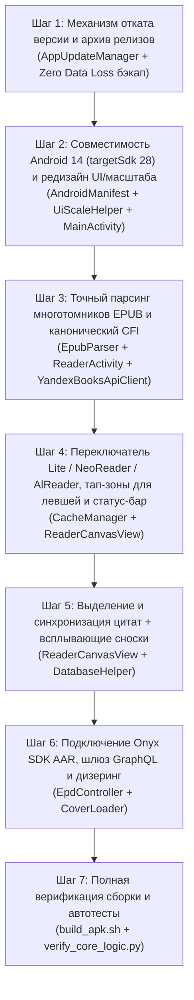

# 🚀 Техническая спецификация модернизации: «Яндекс Книги Lite для Onyx Boox»
## Полное руководство по внедрению улучшений, алгоритмов и интеграций

> **Назначение документа:** Данный документ является исчерпывающим техническим заданием и инженерной инструкцией для нейросети или разработчика по доработке, расширению и устранению узких мест в приложении **«Яндекс Книги Lite»** (`com.onyx.yandexbooks`).  
> В спецификации зафиксированы результаты глубокого реверс-инжиниринга официального клиента **«Яндекс Книги» v6.83** (`ru.plus.bookmate`), извлеченного из CDN Яндекса, и передовой опыт специализированных E-Ink ридеров (**KOReader**, **AlReaderX**).

---

## 📌 Содержание
1. [Карта артефактов и происхождение данных (Evidence & Grounding)](#1-карта-артефактов-и-происхождение-данных)
2. [Модуль 1: Переход на нативный мобильный шлюз GraphQL Gateway](#2-модуль-1-переход-на-нативный-мобильный-шлюз-graphql-gateway)
3. [Модуль 2: Канонический расчет EPUB CFI и точный парсинг многотомников (Omnibus EPUB)](#3-модуль-2-канонический-расчет-epub-cfi-и-точный-парсинг-многотомников-omnibus-epub)
4. [Модуль 3: Аппаратная интеграция официального Onyx SDK (Замена Reflection)](#4-модуль-3-аппаратная-интеграция-официального-onyx-sdk-замена-reflection)
5. [Модуль 4: Всплывающие сноски (Inline Footnotes) без перехода в конец книги](#5-модуль-4-всплывающие-сноски-inline-footnotes-без-перехода-в-конец-книги)
6. [Модуль 5: Сенсорная эргономика — 9-зонная сетка тапов (включая профиль «Для левшей»), жесты подсветки и расширенный статус-бар](#6-модуль-5-сенсорная-эргономика--9-зонная-сетка-тапов-включая-профиль-для-левшей-жесты-подсветки-и-расширенный-статус-бар)
7. [Модуль 6: Алгоритм полутонового дизеринга обложек для E-Ink Carta](#7-модуль-6-алгоритм-полутонового-дизеринга-обложек-для-e-ink-carta)
8. [Модуль 7: Кросс-синхронизация «Текст ⇄ Аудиокнига»](#8-модуль-7-кросс-синхронизация-текст--аудиокнига)
9. [Модуль 8: Интеграция полки пользовательских книг (User Uploads)](#9-модуль-8-интеграция-полки-пользовательских-книг-user-uploads)
10. [Модуль 9: Механизм безопасного отката на предыдущие версии (Downgrade / Архив релизов) с сохранением библиотеки и токена](#10-модуль-9-механизм-безопасного-отката-на-предыдущие-версии-downgrade--архив-релизов-с-сохранением-библиотеки-и-токена)
11. [Модуль 10: Совместимость установки с Android 12–14+ (Onyx Boox Go 10.3, Bigme B6) без потери поддержки Android 4.2](#11-модуль-10-совместимость-установки-с-android-1214-onyx-boox-go-103-bigme-b6-без-потери-поддержки-android-42)
12. [Модуль 11: Адаптация UI для больших экранов (10.3" 2480×1860), устранение обрезки кнопок и редизайн главного меню](#12-модуль-11-адаптация-ui-для-больших-экранов-103-24801860-устранение-обрезки-кнопок-и-редизайн-главного-меню)
13. [Модуль 12: Прямой переключатель режима чтения с поддержкой AlReader и NeoReader](#13-модуль-12-прямой-переключатель-режима-чтения-с-поддержкой-alreader-и-neoreader)
14. [Модуль 13: Выделение, сохранение и облачная синхронизация цитат (Quotes & Highlights)](#14-модуль-13-выделение-сохранение-и-облачная-синхронизация-цитат-quotes--highlights)
15. [Пошаговый чеклист внедрения и верификации для ИИ-агента](#15-пошаговый-чеклист-внедрения-и-верификации-для-ии-агента)

---

## 1. Карта артефактов и происхождение данных

Для реализации задач используйте следующие физические файлы и пути в репозитории:

| Компонент / Артефакт | Путь в проекте | Описание / Назначение |
| :--- | :--- | :--- |
| **Исходный код Lite** | `01_onyx_yandex_books/app/src/main/java/com/onyx/yandexbooks/` | Основное дерево Java-исходников проекта |
| **Официальный Onyx SDK (AAR)** | `onyx_sdk/aar/onyxsdk-device-1.3.6.aar`<br>`onyx_sdk/aar/onyxsdk-base-1.8.9.aar` | Бинарные библиотеки Onyx (выгружены из `repo.boox.com`) |
| **Распакованные JAR SDK** | `onyx_sdk/jars/onyxsdk-device-1.3.6.jar` | Для инспектирования сигнатур методов и классов |
| **Готовые Kotlin-фасады** | `onyx_sdk/kotlin/OnyxEinkController.kt`<br>`onyx_sdk/kotlin/OnyxKeyReceiver.kt` | Эталонная реализация фасада с Graceful Degradation |
| **Архитектурный отчет реверса** | `YANDEX_BOOKS_ONYX_SYNC_REPORT.md` | Полное описание GraphQL схем, батчинга и структур |
| **Скрипт сборки** | `01_onyx_yandex_books/build_apk.sh` | Скрипт трансляции, компиляции DEX и упаковки APK |
| **Тестовый раннер** | `01_onyx_yandex_books/tools/run_full_system_test.py` | Автоматическая проверка корректности ядра |

---

## 2. Модуль 1: Переход на нативный мобильный шлюз GraphQL Gateway

### 2.1. Проблема и контекст
* **Где смотреть:** Файл `01_onyx_yandex_books/app/src/main/java/com/onyx/yandexbooks/core/api/YandexBooksApiClient.java`, строки 44–46:
  ```java
  private static final String BASE_URL = "https://api.bookmate.yandex.net/api/v5";
  private static final String GRAPHQL_URL = "https://books.yandex.ru/node-api/p-graphql/";
  ```
* **Почему нужно менять:** `node-api/p-graphql/` — это веб-прокси Node.js веб-интерфейса `books.yandex.ru`. Он периодически требует валидации веб-кук, имеет повышенный TTFB (Time to First Byte) и может возвращать HTML с проверкой Cloudflare/Яндекс-капчи при частых запросах с ридера.
* **Что выявлено в официальном APK v6.83:**
  Официальный мобильный клиент обращается к специализированному мобильному шлюзу:
  * Основной GraphQL Endpoint: `https://api-gateway.bookmate.yandex.net/graphql`
  * Резервный REST Gateway: `https://api-gateway-rest.bookmate.yandex.net`

### 2.2. План реализации в `YandexBooksApiClient.java`
1. Заменить константы эндпоинтов на двухступенчатую схему с автоматическим Fallback:
   ```java
   private static final String PRIMARY_GRAPHQL_URL = "https://api-gateway.bookmate.yandex.net/graphql";
   private static final String FALLBACK_GRAPHQL_URL = "https://books.yandex.ru/node-api/p-graphql/";
   ```
2. Обновить заголовки в методе `createGraphQLRequestBuilder(String url)`:
   * Добавить заголовок `X-App-Id: ru.plus.bookmate`
   * Добавить заголовок `X-App-Platform: android`
   * Добавить заголовок `X-App-Version: 6.83.0`
   * Убедиться в передаче `Auth-Token` (OAuth токен Яндекс ID).
3. В обработчике ответа GraphQL (`sendReadingProgress` и `fetchReadingProgress`): если `PRIMARY_GRAPHQL_URL` возвращает код 403, 502 или сетевую ошибку — автоматически повторять запрос на `FALLBACK_GRAPHQL_URL`.

---

## 3. Модуль 2: Канонический расчет EPUB CFI и точный парсинг многотомников (Omnibus EPUB)

### 3.1. Проблема и контекст (Кейс сборника «Всадники Перна» — 4 книги в 1 EPUB)
* **Где смотреть:** 
  * `01_onyx_yandex_books/app/src/main/java/com/onyx/yandexbooks/core/api/YandexBooksApiClient.java` (строки 1641–1646)
  * `01_onyx_yandex_books/app/src/main/java/com/onyx/yandexbooks/core/epub/EpubParser.java` (строки 267–370, 560–575)
  * `01_onyx_yandex_books/app/src/main/java/com/onyx/yandexbooks/ui/ReaderActivity.java` (строки 1274–1284, 2893–2923, 3040–3056)
* **Зафиксированные симптомы у пользователей:**
  1. В многотомном EPUB-сборнике (4 книги в одном файле) в верхнем колонтитуле отображается `Глава 5`, тогда как фактически открыта **Книга 4, Глава 17**, а в нижней панели меню написано `Глава 17`.
  2. После отправки прогресса (91%) в облако Яндекс Книг, на других устройствах прогресс сбрасывается на **24%** (на 5-ю главу 2-й книги).
* **Точная техническая диагностика (Root Cause):**
  1. **Коллизия одноименных файлов в подпапках многотомника (`hrefsMatch` и `populateTocTitles`):** В сборниках структура архива часто имеет вид `OEBPS/Book1/ch05.xhtml`, `OEBPS/Book2/ch05.xhtml`, `OEBPS/Book4/ch17.xhtml`. В `EpubParser.populateTocTitles()` и `hrefsMatch()` сейчас есть fallback сопоставления только по короткому имени файла (`fname`), который затирает пути разных томов!
  2. **Досрочное прерывание `break` в `ReaderActivity.findActiveTocTitle()`:** Цикл поиска заголовка в `findActiveTocTitle` делает `else if (node.spineIndex > curSpineIndex) break;`. Если в иерархическом `toc.ncx` хотя бы один узел имел неразрешенный или сдвинутый `spineIndex`, поиск обрывается на ранней главе (`Глава 5`), тогда как нижняя панель `updateMenuControls()` берет заголовок из `chapters.get(currentChapterIndex).getTitle()` (`Глава 17`).
  3. **Сдвиг индекса `<spine>` при генерации CFI:** В `EpubParser.parseOpfSpine` и при вставке искусственной обложки `ch_0_cover` нарушается взаимно-однозначное соответствие между внутренним `currentChapterIndex` и каноническим порядковым номером `<itemref>` в `content.opf`. В результате `generateCfi` отправляет на сервер индекс, который в официальном клиенте соответствует 24% книги.

### 3.2. Алгоритм исправления
1. **В `EpubParser.java`:**
   * В класс `ChapterData` (и модель `Chapter`) добавить поля `originalOpfSpineIndex` (строгий 0-based индекс в `<spine>` манифеста `content.opf` без пропуска дублей и без смещения от `ch_0_cover`) и `opfItemId`.
   * В `hrefsMatch(String a, String b)` сравнивать нормализованные относительные пути внутри архива (`OEBPS/Book2/ch05.xhtml` $\neq$ `OEBPS/Book4/ch05.xhtml`), используя fallback по короткому имени файла **только** если во всем архиве это имя файла уникально.
   * При обходе дерева `TocNode` сохранять для вложенных глав хлебные крошки родительского тома: например, `Книга 4 • Глава 17` (если у родительского узла `level == 0` есть дочерние главы).
2. **В `ReaderActivity.java`:**
   * Убрать преждевременный `break` в `findActiveTocTitle()` — проверять все узлы `flat` на условие `node.spineIndex == curSpineIndex && node.charOffset <= curCharOffset`.
   * Использовать единый метод `getActiveChapterTitle()` как для верхнего колонтитула холста (`ReaderCanvasView`), так и для нижней панели меню (`readerChapterTitleView`).
3. **Формат канонического CFI для Яндекс Книг:**
   ```java
   public static String buildCanonicalCfi(int originalOpfSpineIndex, String opfItemId, int paragraphDomIndex, int charOffset) {
       // В стандартах IDPF: /6/{(originalOpfSpineIndex + 1) * 2} обозначает точный элемент <spine> в content.opf
       int spineCfiIndex = (originalOpfSpineIndex + 1) * 2;
       int pCfiIndex = Math.max(2, (paragraphDomIndex + 1) * 2);
       if (opfItemId != null && !opfItemId.isEmpty()) {
           return String.format(Locale.US, "epubcfi(/6/%d[%s]!/4/%d/1:%d)",
                   spineCfiIndex, opfItemId, pCfiIndex, Math.max(0, charOffset));
       }
       return String.format(Locale.US, "epubcfi(/6/%d!/4/%d:%d)",
               spineCfiIndex, pCfiIndex, Math.max(0, charOffset));
   }
   ```
4. **Обратный парсинг входящего CFI с сервера (когда читали на смартфоне):**
   * Извлекать `spineCfiIndex` (`/6/N` $\to$ `originalOpfSpineIndex = (N / 2) - 1`) и `opfItemId` в квадратных скобках `[...]`, находя точную главу в локальном списке глав без риска сброса позиции.

---

## 4. Модуль 3: Аппаратная интеграция официального Onyx SDK (Замена Reflection)

### 4.1. Проблема и контекст
* **Где смотреть:** `01_onyx_yandex_books/app/src/main/java/com/onyx/yandexbooks/core/eink/EpdController.java`.
* В текущей реализации вызовы управления экраном осуществляются через `Class.forName("android.view.View")` и эмуляцию строковых Intent-экшенов. Это работает нестабильно на новых версиях Onyx OS (Android 10/11/12), где системные сигнатуры изменились.
* **Что у нас есть:** В каталоге `onyx_sdk/aar/` сохранен официальный бинарник `onyxsdk-device-1.3.6.aar`.

### 4.2. План подключения библиотеки в проект

1. **В `01_onyx_yandex_books/app/build.gradle` (или `build_apk.sh`):**
   * Добавить зависимость на локальный AAR:
     ```groovy
     repositories {
         flatDir {
             dirs '../../onyx_sdk/aar'
         }
     }
     dependencies {
         compile(name: 'onyxsdk-device-1.3.6', ext: 'aar')
         compile(name: 'onyxsdk-base-1.8.9', ext: 'aar')
     }
     ```
2. **Переписать `EpdController.java` с использованием прямых типизированных вызовов:**
   ```java
   package com.onyx.yandexbooks.core.eink;

   import android.os.Build;
   import android.view.View;
   import com.onyx.android.sdk.api.device.epd.EpdController;
   import com.onyx.android.sdk.api.device.brightness.BrightnessController;
   import com.onyx.android.sdk.api.device.brightness.BrightnessType;

   public class EpdControllerHelper {

       private static final boolean IS_ONYX = isOnyxDevice();

       public static boolean isOnyxDevice() {
           String m = Build.MANUFACTURER.toLowerCase();
           String b = Build.BRAND.toLowerCase();
           return m.contains("onyx") || b.contains("onyx");
       }

       // 1. Аппаратный Regal Mode (устранение остаточных артефактов без мигания)
       public static void enableRegal(View view) {
           if (!IS_ONYX) return;
           try {
               EpdController.enableRegal(true);
               EpdController.applyAppScopeUpdate(true);
           } catch (Throwable t) {
               t.printStackTrace();
           }
       }

       // 2. Глубокая очистка экрана (Deep GC Full Refresh)
       public static void fullRefresh(View view) {
           if (!IS_ONYX) return;
           try {
               if (view != null) {
                   EpdController.applyGCOnce(view);
               } else {
                   EpdController.applyGCOnce();
               }
           } catch (Throwable t) {
               t.printStackTrace();
           }
       }

       // 3. Быстрый режим A2 (для списков, поиска и скролла каталога)
       public static void setA2Mode(View view, boolean enable) {
           if (!IS_ONYX || view == null) return;
           try {
               if (enable) {
                   EpdController.enableA2ForSpecificView(view);
               } else {
                   EpdController.disableA2ForSpecificView(view);
               }
           } catch (Throwable t) {
               t.printStackTrace();
           }
       }

       // 4. Прямое управление двухтоновой подсветкой CTM (Cold / Warm)
       public static void setFrontlight(android.content.Context ctx, int coldVal, int warmVal) {
           if (!IS_ONYX) return;
           try {
               BrightnessController.setBrightness(ctx, coldVal, BrightnessType.Cold);
               BrightnessController.setBrightness(ctx, warmVal, BrightnessType.Warm);
           } catch (Throwable t) {
               t.printStackTrace();
           }
       }
   }
   ```

---

## 5. Модуль 4: Всплывающие сноски (Inline Footnotes) без перехода в конец книги

### 5.1. Проблема
В классических встроенных ридерах при нажатии на цифру сноски (например, `[1]`) движок переходит по ссылке `href="notes.xhtml#n1"` в конец книги. Пользователь теряет текущую страницу чтения, ломается прогресс, а возврат назад на E-Ink требует 2–3 полных перерисовки экрана.

### 5.2. Архитектура решения
1. **Парсинг сносок в `EpubParser.java`:**
   * При парсинге глав искать теги ссылок `<a href="#...">` или `<aside epub:type="footnote">`.
   * Сохранять карту сносок текущей книги в SQLite: `Map<String, String> footnoteMap` (Ключ: `#note1`, Значение: текст сноски).
2. **Обработка клика в `ReaderCanvasView.java`:**
   * При тапе по координатам текста проверять попадание в `ClickableSpan` или прямоугольник сноски.
   * Если нажат якорь сноски — **не вызывать переход страницы**.
   * Вместо этого отобразить модальную плашку `EinkNotice` в нижней трети экрана:
     ```
     ┌──────────────────────────────────────────────────────┐
     │ 📖 Сноска [1]:                                       │
     │ Франсуа Рабле (1494–1553) — один из величайших       │
     │ французских сатириков эпохи Возрождения.             │
     │                                     [ ЗАКРЫТЬ (ОК) ] │
     └──────────────────────────────────────────────────────┘
     ```
3. После нажатия «Закрыть» экран возвращается к текущей странице без единого сдвига позиции чтения.

---

## 6. Модуль 5: Сенсорная эргономика — 9-зонная сетка тапов (включая профиль «Для левшей»), жесты подсветки и расширенный статус-бар

### 6.1. Регулировка подсветки вертикальными свайпами по кромкам экрана
* **Левый край (0% – 10% ширины экрана):**
  * Свайп вверх $\to$ увеличение теплой подсветки (Warm CTM).
  * Свайп вниз $\to$ уменьшение теплой подсветки.
* **Правый край (90% – 100% ширины экрана):**
  * Свайп вверх $\to$ увеличение холодной подсветки (Cold CTM).
  * Свайп вниз $\to$ уменьшение холодной подсветки.
* **Индикация на E-Ink:** По центру экрана на 1.5 секунды появляется крупный контрастный бейдж: `☀️ Теплый: 45%` или `💡 Холодный: 70%` без фоновой анимации.

### 6.2. Настраиваемая 9-зонная матрица тапов (Tap Zones) и профиль «Для левшей»
В `ReaderCanvasView.onTouchEvent(MotionEvent event)` экран делится по координатам `X` (`0..30%`, `30..70%`, `70..100%`) и `Y` (`0..28%`, `28..72%`, `72..100%`) на сетку `3×3` (9 зон). В настройках «Формат ➔ Вид» добавляется переключатель профилей тап-зон и визуальный редактор 9 квадратов:

1. **Профиль «Стандартный (Правша)»:**
   * Левая колонка (верх, центр, низ) $\to$ **Страница назад**
   * Центральная колонка $\to$ **Меню ридера**
   * Правая колонка (верх, центр, низ) $\to$ **Страница вперед**

2. **Профиль «Для левшей (Left-Handed)» (по запросу пользователей форума):**
   ```
   ┌──────────────┬──────────────┬──────────────┐
   │  СТР. ВПЕРЕД │    МЕНЮ      │  СТР. ВПЕРЕД │  (Верхняя треть: 0% – 28%)
   ├──────────────┼──────────────┼──────────────┤
   │  СТР. НАЗАД  │    МЕНЮ      │  СТР. ВПЕРЕД │  (Средняя треть: 28% – 72%)
   ├──────────────┼──────────────┼──────────────┤
   │  СТР. ВПЕРЕД │    МЕНЮ      │  СТР. ВПЕРЕД │  (Нижняя треть: 72% – 100%)
   └──────────────┴──────────────┴──────────────┘
   ```
   При удержании электронной книги в левой руке большой палец как в верхнем, так и в нижнем хвате комфортно листает **вперед**, а смещение пальца к центру левого края листает **назад**.

3. **Профиль «Пользовательский (Кастомная сетка 3×3)»:**
   * Диалог с интерактивной сеткой `3×3`, где нажатием на любую из 9 ячеек выбирается действие: `Вперед`, `Назад`, `Меню`, `Оглавление`, `Закладка`, `Обновить E-Ink (GC16)`, `Нет действия`.

### 6.3. Расширенная строка состояния (нижний колонтитул) во встроенном ридере
В `ReaderCanvasView.onDraw(Canvas canvas)` модернизируется нижний колонтитул (и добавляется опция полноэкранного чтения со скрытием системного статус-бара Android):
* **Левая часть нижнего колонтитула:** текущее время и заряд батареи устройства:
  `16:22 • Заряд 97%` (данные запрашиваются через `IntentFilter(Intent.ACTION_BATTERY_CHANGED)` и `SimpleDateFormat("HH:mm")` непосредственно в момент отрисовки кадра без фоновых таймеров, что дает 0% расхода энергии).
* **Правая часть нижнего колонтитула:** двойной счетчик страниц — **по текущей главе** и **по всей книге**:
  `Гл: 12/34 • Стр: 2373/2612 (91%)` (где `currentPageIndex + 1` и `currentPages.size()` показывают прогресс внутри текущей главы, а `globalPageIndex / totalBookPages` — сквозной объем книги).

---

## 7. Модуль 6: Алгоритм полутонового дизеринга обложек для E-Ink Carta

### 7.1. Проблема
Цветные обложки при стандартном преобразовании в серый градиент (`Bitmap.Config.RGB_565` или `ALPHA_8`) на 16-градиентной матрице E-Ink теряют детали и покрываются артефактами постеризации (полосами).

### 7.2. Реализация диффузного дизеринга Флойда-Стейнберга в `CoverLoader.java`

```java
package com.onyx.yandexbooks.core.ui;

import android.graphics.Bitmap;
import android.graphics.Color;

public class EinkDitherer {

    // 16 градаций серого (стандарт E-Ink Carta)
    private static final int LEVELS = 16;
    private static final int STEP = 255 / (LEVELS - 1);

    public static Bitmap applyFloydSteinbergDither(Bitmap original) {
        int width = original.getWidth();
        int height = original.getHeight();
        Bitmap dithered = original.copy(Bitmap.Config.ARGB_8888, true);

        int[] pixels = new int[width * height];
        dithered.getPixels(pixels, 0, width, 0, 0, width, height);

        // Буфер яркости (grayscale 0..255)
        int[][] gray = new int[height][width];
        for (int y = 0; y < height; y++) {
            for (int x = 0; x < width; x++) {
                int c = pixels[y * width + x];
                // Яркостная формула Rec. 601 Luma
                gray[y][x] = (int)(0.299 * Color.red(c) + 0.587 * Color.green(c) + 0.114 * Color.blue(c));
            }
        }

        // Распределение ошибки по матрице Флойда-Стейнберга
        for (int y = 0; y < height; y++) {
            for (int x = 0; x < width; x++) {
                int oldVal = gray[y][x];
                // Квантование к ближайшему из 16 уровней
                int newVal = Math.round((float) oldVal / STEP) * STEP;
                newVal = Math.max(0, Math.min(255, newVal));
                gray[y][x] = newVal;

                int err = oldVal - newVal;

                if (x + 1 < width)                 gray[y][x + 1]     += (err * 7) / 16;
                if (x - 1 >= 0 && y + 1 < height)   gray[y + 1][x - 1] += (err * 3) / 16;
                if (y + 1 < height)                 gray[y + 1][x]     += (err * 5) / 16;
                if (x + 1 < width && y + 1 < height) gray[y + 1][x + 1] += (err * 1) / 16;

                pixels[y * width + x] = Color.rgb(newVal, newVal, newVal);
            }
        }

        dithered.setPixels(pixels, 0, width, 0, 0, width, height);
        return dithered;
    }
}
```
**Результат:** Обложка на экране ридера выглядит как четкая типографская гравюра с богатыми полутонами без серых пятен.

---

## 8. Модуль 7: Кросс-синхронизация «Текст ⇄ Аудиокнига»

### 8.1. Как это работает в бэкенде Яндекс Книг
В ответе GraphQL на запрос `query GetBook($uuid: ID!)` возвращаются метаданные связанных форматов:
```json
{
  "data": {
    "textBook": {
      "linkedAudioBook": {
        "uuid": "audio_uuid_99812",
        "currentPosition": {
          "trackIndex": 3,
          "trackSeconds": 540,
          "updatedAt": "2026-11-01T18:20:00Z"
        }
      }
    }
  }
}
```

### 8.2. Реализация в Lite
1. В `ReadingProgress.java` добавить поля:
   * `long audioUpdatedAt`
   * `int audioTrackIndex`
   * `int audioTrackSeconds`
2. При открытии книги в `ReaderActivity`:
   * Сравнить `audioUpdatedAt` с локальным `textUpdatedAt`.
   * Если аудио слушали **позже**, чем читали текст:
     * Найти в оглавлении `Chapter` с индексом `audioTrackIndex`.
     * Отобразить диалог:
       ```
       ┌────────────────────────────────────────────────────────┐
       │ 🎧 Обнаружено прослушивание на смартфоне               │
       │ Вы слушали эту книгу сегодня в 18:20 (Глава 4).        │
       │ Перемотать текст к этому месту?                        │
       │                                                        │
       │         [ ОСТАТЬСЯ ЗДЕСЬ ]     [ ПЕРЕЙТИ К АУДИО ]      │
       └────────────────────────────────────────────────────────┘
       ```

---

## 9. Модуль 8: Интеграция полки пользовательских книг (User Uploads)

### 9.1. Протокол Bookmate User Uploads
Пользователи часто загружают свои книги через `books.yandex.ru/upload`.
Официальный API возвращает их по эндпоинту:
```http
GET https://api.bookmate.yandex.net/api/v5/profile/user_books
Headers:
  Auth-Token: <OAUTH_TOKEN>
```
Формат ответа:
```json
{
  "user_books": [
    {
      "uuid": "usr_book_1029",
      "title": "Мой файл.epub",
      "authors": ["Неизвестен"],
      "format": "epub",
      "file_url": "https://storage.yandex.net/user_books/usr_book_1029.epub",
      "library_card": {
        "percent": 42.5,
        "updated_at": "2026-10-30T12:00:00Z"
      }
    }
  ]
}
```

### 9.2. Внедрение в Lite
* В `YandexBooksApiClient.java` добавить метод `fetchUserUploadedBooks(ApiCallback<List<Book>> callback)`.
* В `MainActivity.java` в список полок («Читаю», «В планах», «Каталог») добавить пятую вкладку или пункт меню: **«Мои файлы»**.
* Книги из этого раздела скачиваются по прямой ссылке `file_url` и открываются в нативном `ReaderCanvasView` с сохранением полного цикла синхронизации процента и закладок.

---

## 10. Модуль 9: Механизм безопасного отката на предыдущие версии (Downgrade / Архив релизов) с сохранением библиотеки и токена

> **Приоритет внедрения:** Включено отдельным обязательным пунктом в состав **первого этапа решений (Phase 1)** по модернизации приложения, наряду с подключением Onyx SDK и переходом на шлюз `api-gateway.bookmate.yandex.net`.

### 10.1. Проблема и системное ограничение Android
* **Причина блокировки:** В системном сервисе Android `PackageManagerService` (PMS) на уровне ядра безопасности зашит запрет на прямое понижение версии (`newVersionCode < currentVersionCode`). При попытке накатить APK поверх существующего без предварительного удаления система возвращает ошибку `INSTALL_FAILED_VERSION_DOWNGRADE`.
* **Задача:** Реализовать надежный и прозрачный для пользователя ридера механизм отката на любую ранее выпущенную версию из архива GitHub Releases с сохранением всех локальных данных пользователя (авторизации, полок, скачанных книг, закладок и позиции чтения).

### 10.2. Архитектурный протокол реализации

#### Этап 1: Интерфейс «Архив версий» в `AppUpdateManager`
* В диалоге «Обновление ПО» (или через вызов «История версий / Откат») формируется запрос к GitHub API:
  `GET https://api.github.com/repos/litvaerickson-spec/onyx-yandex-books/releases?per_page=30`
* Парсинг ответа: извлечение всех релизов с тегами `vX.Y.Z`, кратким описанием изменений, датой выпуска и прямой ссылкой на бинарный APK (`assets`).
* Отображение на экране ридера в виде постраничного E-Ink списка с кнопкой **«Откатиться на vX.X.X»**.

#### Этап 2: Автоматический бэкап данных перед откатом (Zero Data Loss)
Перед запуском процедуры понижения версии `AppUpdateManager` автоматически сохраняет состояние в энергонезависимую директорию внешней памяти устройства `/sdcard/Books/YandexBooks/backup/` (эта директория сохраняется даже при полном удалении приложения системой):
1. **Экспорт базы SQLite:** Копирование текущей базы `books.db` (с таблицами `books`, `progress`, `bookmarks`, `sync_queue`) в `/sdcard/Books/YandexBooks/backup/backup_books.db`.
2. **Экспорт токена и настроек:** Сериализация SharedPreferences (`yandex_auth_token`, настройки верстки и шрифтов) в `/sdcard/Books/YandexBooks/backup/backup_auth.json`.
3. **Сохранность скачанных книг:** Все EPUB-файлы уже хранятся в `/sdcard/Books/YandexBooks/` и не затрагиваются удалением.

#### Этап 3: Скачивание архивного APK и вызов переустановки
1. Приложение скачивает выбранный APK (например, `yandex-books-lite-v1.5.15-beta.apk`) в публичную папку `/sdcard/Download/`.
2. Показывается контрастное предупреждение `EinkNotice`: *«Для отката на предыдущую версию Android требует подтвердить удаление текущей версии. Ваши книги, закладки и авторизация сохранены в резервной копии и восстановятся автоматически»*.
3. Вызывается системный интент удаления:
   ```java
   Intent uninstallIntent = new Intent(Intent.ACTION_UNINSTALL_PACKAGE);
   uninstallIntent.setData(Uri.parse("package:com.onyx.yandexbooks"));
   uninstallIntent.putExtra(Intent.EXTRA_RETURN_RESULT, true);
   context.startActivity(uninstallIntent);
   ```
4. Сразу после удаления (или через системный сервис загрузок/проводник) открывается системный установщик скачанного APK через `Intent.ACTION_VIEW` с MIME `application/vnd.android.package-archive`.

#### Этап 4: Автоматическое восстановление при первом старте старой версии
* В `DatabaseHelper.java` и `AppSettings.java` добавляется проверка при инициализации:
  - Если локальная база пуста, но обнаружен файл `/sdcard/Books/YandexBooks/backup/backup_books.db`, база мгновенно копируется на место рабочей базы.
  - Если токен в SharedPreferences отсутствует, но найден `backup_auth.json`, токен восстанавливается без повторного ввода логина или сканирования QR-кода.

---

## 11. Модуль 10: Совместимость установки с Android 12–14+ (Onyx Boox Go 10.3, Bigme B6) без потери поддержки Android 4.2

### 11.1. Проблема и контекст (Кейсы Onyx Boox Go 10.3 и Bigme B6 на Android 14)
* **Симптом от пользователей:** На современных электронных книгах с Android 12–14 (**Onyx Boox Go 10.3**, **Bigme B6**) стандартный установщик APK блокирует установку с ошибкой *«Приложение несовместимо с вашим устройством»* (`INSTALL_FAILED_DEPRECATED_SDK_VERSION`), требуя установки через ПК с флагом `adb install --bypass-low-target-sdk-block`.
* **Точная техническая причина:** В `AndroidManifest.xml` и `build_apk.sh` сейчас указан `android:targetSdkVersion="19"`. Начиная с Android 14 (API 34) и свежих патчей безопасности Google Play Protect на Android 12+, система принудительно блокирует установку любых APK с `targetSdkVersion < 23` (или `< 24`).

### 11.2. Архитектура решения (100% совместимость от Android 4.2 до Android 14/15)
1. **В `AndroidManifest.xml` и `build_apk.sh`:**
   * Сохранить `android:minSdkVersion="17"` (полная работоспособность на Android 4.2.2+ для Onyx Boox Darwin 1–6).
   * Повысить `android:targetSdkVersion` с `19` до **`28` (Android 9.0 Pie)**:
     ```xml
     <uses-sdk
         android:minSdkVersion="17"
         android:targetSdkVersion="28" />
     ```
   * В тег `<application>` добавить атрибут `android:requestLegacyExternalStorage="true"` и `android:usesCleartextTraffic="true"` (для работы локального Wi-Fi моста авторизации на порту `8888`).
2. **Динамический запрос разрешений памяти на Android 6.0+ (API 23+):**
   * При `targetSdkVersion="28"` на Android 6.0–14 необходимо вызывать runtime-проверку разрешений для записи книг в `/sdcard/Books/YandexBooks/` (через рефлексию или `Build.VERSION.SDK_INT >= 23`, чтобы код компилировался и работал на API 17):
     ```java
     if (Build.VERSION.SDK_INT >= 23) {
         if (checkSelfPermission(Manifest.permission.WRITE_EXTERNAL_STORAGE) != PackageManager.PERMISSION_GRANTED) {
             requestPermissions(new String[]{
                 Manifest.permission.READ_EXTERNAL_STORAGE,
                 Manifest.permission.WRITE_EXTERNAL_STORAGE
             }, 1002);
         }
     }
     ```
   * При этом все основные данные (кэш глав, база данных, EPUB для встроенного ридера) хранятся во внутреннем каталоге приложения `getFilesDir()`, который вообще не требует внешних разрешений ни на какой версии Android.
3. **Подпись APK (Scheme v1 + v2 + v3):**
   * В `build_apk.sh` выполнять выравнивание `zipalign -f 4` и подпись `apksigner sign --v1-signing-enabled true --v2-signing-enabled true --v3-signing-enabled true`, что обеспечивает установку в 1 клик и на Android 4.2, и на Android 14+.

---

## 12. Модуль 11: Адаптация UI для больших экранов (10.3" 2480×1860), устранение обрезки кнопок и редизайн главного меню

### 12.1. Проблемы, выявленные по скриншотам с Onyx Boox Go 10.3
1. **Обрезка текста кнопок в карточке книги:** При масштабе интерфейса 160% кнопки справа в списке книг обрезаются с троеточием: `Чита...` и `О кни...`.
2. **Мелкие панели и кнопки на 10.3" экранах:** На экранах с разрешением 2480×1860 верхняя шапка (`28dp`), вкладки (`28dp`), нижний бар (`26dp`) и кнопки меню остаются слишком мелкими даже на максимальном масштабе 160%.
3. **Неоднозначность кнопки «Закрыть» в «Меню приложения»:** Пользователи воспринимают нижнюю кнопку «Закрыть» в главном меню как выход из самого приложения, тогда как она просто закрывает всплывающее окно меню (которое и так закрывается тапом вне окна).

### 12.2. План реализации
1. **Устранение обрезки `Чита...` / `О кни...` в `item_book.xml`:**
   * Заменить фиксированную узкую ширину контейнера кнопок на `android:layout_width="wrap_content"` с `android:minWidth="84dp"`, `android:paddingLeft="10dp"`, `android:paddingRight="10dp"` и запретить эллипсис (`ellipsize="none"`), чтобы надписи **«Читать»** и **«О книге»** всегда помещались целиком при любом масштабе интерфейса.
2. **Адаптивное масштабирование для больших диагоналей (7.8" – 10.3" – 13.3") в `UiScaleHelper.java`:**
   * Увеличить базовые высоты верхней панели (`28dp` $\to$ `38dp`), панели вкладок (`28dp` $\to$ `38dp`), нижнего бара (`26dp` $\to$ `36dp`) и кнопок карточки книги (`26dp` $\to$ `34dp`).
   * Расширить шкалу масштабирования в `AppSettings` и `showUiScaleDialog()`: добавить уровни **`180% (Планшет 10")`** и **`200% (Максимум)`**.
   * Добавить рекурсивный масштабатор дерева View (`UiScaleHelper.applyViewTreeScale(View root, float scale)`), который гарантированно умножает `LayoutParams.height`, `padding` и `textSize` всех элементов, даже если прошивка Android 12–14 игнорирует `res.updateConfiguration()`.
3. **Модернизация «Меню приложения» в `MainActivity.java`:**
   * В шапку диалога «Меню приложения» справа добавить контрастную кнопку **`[ X ]`** для быстрого закрытия самого меню.
   * Нижнюю кнопку разделить на две понятные кнопки (или переименовать):
     - **`[ Свернуть меню ]`** (`dialog.dismiss()`)
     - **`[ Выйти из приложения ]`** (`finishAffinity()` / `finish()`) — полноценное закрытие приложения и выход на домашний экран устройства.

---

## 13. Модуль 12: Прямой переключатель режима чтения с поддержкой AlReader и NeoReader

### 13.1. Проблема и контекст
* Сейчас кнопка режима чтения в правом верхнем углу переключает только 2 состояния (`Онлайн/Lite` $\leftrightarrow$ `Onyx`), а при открытии книги в режиме `Onyx` отправляется общий `Intent.ACTION_VIEW`, который прошивка Onyx Boox по умолчанию открывает в `NeoReader`, не позволяя легко выбрать `AlReader` без ручного сброса системных настроек по умолчанию.

### 13.2. Архитектура циклического выбора и прямого запуска (`Lite ➔ NeoReader ➔ AlReader ➔ Выбор`)
1. **Расширение констант режимов в `AppSettings.java`:**
   * `READER_MODE_LITE = "lite"` — **Встроенный ридер** (с полной облачной синхронизацией).
   * `READER_MODE_NEOREADER = "neoreader"` — **Onyx NeoReader** (системный ридер Onyx).
   * `READER_MODE_ALREADER = "alreader"` — **AlReader / AlReaderX** (прямой запуск без системных диалогов).
   * `READER_MODE_CHOOSER = "chooser"` — **Системный выбор** (всегда показывает список установленных программ для чтения).
2. **Циклическое переключение и выбор из списка:**
   * Короткое нажатие на кнопку режима в верхней панели `MainActivity` переключает режимы по кругу: **`Lite` $\to$ `NeoReader` $\to$ `AlReader` $\to$ `Выбор`** (пропуская те приложения, которые физически не установлены на устройстве, или показывая понятное уведомление).
   * Долгое нажатие на эту же кнопку открывает модальное окно «Выбор приложения для чтения по умолчанию» со списком всех найденных на устройстве программ.
3. **Прямая адресация пакетов в `CacheManager.openInExternalReader()`:**
   * Для **AlReader** проверять наличие установленных пакетов через `PackageManager`:
     - `com.neverland.alreader` (AlReader3)
     - `com.neverland.alreaderx` / `com.neverland.alreaderxpro` (AlReaderX)
     - `com.neverland.alreader.onyx` (предустановленный AlReader на Onyx Boox)
   * Для **NeoReader** проверять пакеты:
     - `com.onyx.kreader`, `com.onyx.reader`, `cn.onyxsdk.neoreader`
   * Передавать выбранный пакет в `intent.setPackage(targetPackage)` и использовать `FileProvider` / безопасный `Uri` для Android 10–14.

---

## 14. Модуль 13: Выделение, сохранение и облачная синхронизация цитат (Quotes & Highlights)

### 14.1. Архитектура работы с цитатами во встроенном ридере
1. **Выделение текста на холсте `ReaderCanvasView.java`:**
   * В ` TextPaginator.Line` сохранять массив координат слов `WordBox(startX, endX, startCharOffset, endCharOffset)`.
   * При долгом нажатии (`LongPress` $\ge 500$ мс) и ведении пальца по странице выделять выбранный диапазон текста контрастной рамкой / инверсной заливкой.
   * При отпускании пальца показывать компактную панель действий:
     **`[ Сохранить цитату ]`** | **`[ С заметкой ]`** | **`[ Копировать ]`** | **`[ Отмена ]`**.
2. **Локальное хранение и интерфейс просмотра:**
   * В `DatabaseHelper.java` добавить таблицу `quotes`:
     `id`, `book_uuid`, `quote_uuid`, `chapter_index`, `start_offset`, `end_offset`, `cfi`, `text`, `note`, `created_at`, `synced`.
   * В диалог «Содержание и закладки» (`ReaderActivity.showTableOfContentsDialog()`) добавить третью вкладку:
     **`[ Оглавление ]` | `[ Закладки ]` | `[ Цитаты ]`**.
   * Добавить кнопку **«Экспорт цитат в файл»**, сохраняющую все цитаты книги в читаемый файл `/sdcard/Books/YandexBooks/Quotes/<Название_книги>_цитаты.txt` (и `.md`).
3. **Двусторонняя синхронизация цитат с облаком Яндекс Книг:**
   * В `YandexBooksApiClient.java` реализовать методы:
     - `getBookQuotes(String bookUuid, ApiCallback<List<Quote>> callback)` — загрузка цитат пользователя с сервера (`GET /api/v5/books/{uuid}/quotes` и GraphQL `bookQuotes`).
     - `createBookQuote(Quote quote, ApiCallback<Boolean> callback)` — отправка новой цитаты с каноническим `cfi` и текстом в облако Яндекс Книг.

---

## 15. Пошаговый чеклист внедрения и верификации для ИИ-агента

### 15.1. Этапы и очередность внедрения



#### 🥇 Этап 1 (Первоочередные изменения: откат версий, критическая совместимость, парсинг и UX по отзывам 4PDA):
1. **Механизм безопасного отката версий (Downgrade / Архив релизов) с сохранением библиотеки и токена (Модуль 9):** диалог выбора любой предыдущей версии через GitHub Releases API, автоматический Zero Data Loss бэкап базы SQLite и авторизации в `/sdcard/Books/YandexBooks/backup/` перед удалением, безопасная переустановка и авто-восстановление при старте.
2. **Совместимость установки с Android 12–14+ (Модуль 10):** повышение `targetSdkVersion` до `28` при сохранении `minSdkVersion="17"` для установки в 1 клик без ADB на **Onyx Boox Go 10.3** и **Bigme B6**.
3. **Точный парсинг многотомников EPUB и канонический CFI (Модуль 2):** устранение рассинхрона заголовков глав («Глава 5» vs «Глава 17»), хлебные крошки томов (`Книга 4 • Глава 17`) и сохранение истинного `originalOpfSpineIndex`, исключающее сброс прогресса на 24%.
4. **Крупный интерфейс для 10.3" экранов, исправление обрезки кнопок и редизайн меню (Модуль 11):** устранение троеточий `Чита...` / `О кни...`, реальное масштабирование до `200%`, добавление кнопки **«Выйти из приложения»** и кнопки **`[ X ]`** в главное меню.
5. **Прямой выбор режима чтения `Lite ➔ NeoReader ➔ AlReader` (Модуль 12):** запуск книги напрямую в AlReader или NeoReader одной кнопкой без настройки системных ассоциаций.
6. **Тап-зоны «Для левшей» и расширенный статус-бар (Модуль 5):** настройка 9 зон касания (верх/низ слева = вперед, центр слева = назад) и вывод в нижнем колонтитуле времени, заряда батареи и страниц текущей главы + всей книги (`Гл: X/Y • Стр: A/B (Z%)`).

#### 🥈 Этап 2 (Мобильный шлюз, Onyx SDK, цитаты и сноски):
7. **Подключение официального Onyx SDK AAR и переход на мобильный шлюз GraphQL (Модули 1, 3):** подключение `https://api-gateway.bookmate.yandex.net/graphql` и нативного `EpdController`.
8. **Сохранение и синхронизация цитат (Модуль 13):** выделение текста в `ReaderCanvasView`, вкладка «Цитаты», экспорт в файл и синхронизация с облаком Яндекса.
9. **Всплывающие сноски (Inline Footnotes) (Модуль 4):** модальные сноски `EinkNotice` прямо на странице без перехода в конец книги.

#### 🥉 Этап 3 (Расширения экосистемы и графики):
10. **Полутоновый дизеринг обложек и жесты подсветки (Модули 5.1, 6):** алгоритм Флойда-Стейнберга и свайпы регулировки теплого/холодного света.
11. **Полка пользовательских книг (User Uploads) и кросс-синхронизация аудио (Модули 7, 8):** доступ к личным загруженным книгам из облака Bookmate.

### 15.2. Контрольный протокол проверки:
1. **Синтаксическая проверка:**
   ```bash
   javac -cp "app/libs/*:android.jar" $(find app/src/main/java -name "*.java")
   ```
2. **Сборка APK:**
   ```bash
   cd 01_onyx_yandex_books && ./build_apk.sh
   ```
3. **Запуск интеграционных тестов ядра:**
   ```bash
   python3 01_onyx_yandex_books/tools/run_full_system_test.py
   python3 01_onyx_yandex_books/tools/verify_core_logic.py
   ```
4. **Контроль обратной совместимости:**
   Убедиться, что вызовы `onyxsdk` обернуты в `try/catch` с условием `Build.MANUFACTURER.contains("onyx")`, чтобы приложение гарантированно запускалось на Android 4.2–4.4 и не падало на устройствах сторонних брендов.
