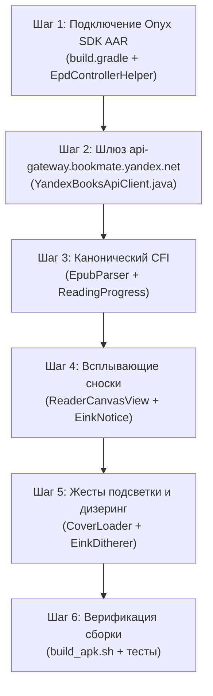

# 🚀 Техническая спецификация модернизации: «Яндекс Книги Lite для Onyx Boox»
## Полное руководство по внедрению улучшений, алгоритмов и интеграций

> **Назначение документа:** Данный документ является исчерпывающим техническим заданием и инженерной инструкцией для нейросети или разработчика по доработке, расширению и устранению узких мест в приложении **«Яндекс Книги Lite»** (`com.onyx.yandexbooks`).  
> В спецификации зафиксированы результаты глубокого реверс-инжиниринга официального клиента **«Яндекс Книги» v6.83** (`ru.plus.bookmate`), извлеченного из CDN Яндекса, и передовой опыт специализированных E-Ink читалок (**KOReader**, **AlReaderX**).

---

## 📌 Содержание
1. [Карта артефактов и происхождение данных (Evidence & Grounding)](#1-карта-артефактов-и-происхождение-данных)
2. [Модуль 1: Переход на нативный мобильный шлюз GraphQL Gateway](#2-модуль-1-переход-на-нативный-мобильный-шлюз-graphql-gateway)
3. [Модуль 2: Канонический расчет EPUB CFI для точной синхронизации со смартфонами](#3-модуль-2-канонический-расчет-epub-cfi-для-точной-синхронизации-со-смартфонами)
4. [Модуль 3: Аппаратная интеграция официального Onyx SDK (Замена Reflection)](#4-модуль-3-аппаратная-интеграция-официального-onyx-sdk-замена-reflection)
5. [Модуль 4: Всплывающие сноски (Inline Footnotes) без перехода в конец книги](#5-модуль-4-всплывающие-сноски-inline-footnotes-без-перехода-в-конец-книги)
6. [Модуль 5: Сенсорная эргономика — 9-зонная сетка тапов и жесты подсветки](#6-модуль-5-сенсорная-эргономика--9-зонная-сетка-тапов-и-жесты-подсветки)
7. [Модуль 6: Алгоритм полутонового дизеринга обложек для E-Ink Carta](#7-модуль-6-алгоритм-полутонового-дизеринга-обложек-для-e-ink-carta)
8. [Модуль 7: Кросс-синхронизация «Текст ⇄ Аудиокнига»](#8-модуль-7-кросс-синхронизация-текст--аудиокнига)
9. [Модуль 8: Интеграция полки пользовательских книг (User Uploads)](#9-модуль-8-интеграция-полки-пользовательских-книг-user-uploads)
10. [Пошаговый чеклист внедрения и верификации для ИИ-агента](#10-пошаговый-чеклист-внедрения-и-верификации-для-ии-агента)

---

## 1. Карта артефактов и происхождение данных

Для реализации задач используйте следующие физические файлы и пути в репозитории:

| Компонент / Артефакт | Путь в проекте | Описание / Назначение |
| :--- | :--- | :--- |
| **Исходный код Lite** | `01_onyx_yandex_books/app/src/main/java/com/onyx/yandexbooks/` | Основное дерево Java-исходников проекта |
| **Официальный Onyx SDK (AAR)** | `onyx_sdk/aar/onyxsdk-device-1.3.6.aar`<br>`onyx_sdk/aar/onyxsdk-base-1.8.9.aar` | Бинарные библиотеки Onyx (выгружены из `repo.boox.com`) |
| **Распакованные JAR SDK** | `onyx_sdk/jars/onyxsdk-device-1.3.6.jar` | Для инспектирования сигнатур методов и классов |
| **Готовые Kotlin-фасады** | `onyx_sdk/kotlin/OnyxEinkController.kt`<br>`onyx_sdk/kotlin/OnyxKeyReceiver.kt` | Эталонная реализация фасада с Graceful Degradation |
| **Архитектурный отчет реверса** | `YANDEX_BOOKS_ONYX_SYNC_REPORT.md` | Полное описание GraphQL схем, батчинга и структур |
| **Скрипт сборки** | `01_onyx_yandex_books/build_apk.sh` | Скрипт трансляции, компиляции DEX и упаковки APK |
| **Тестовый раннер** | `01_onyx_yandex_books/tools/run_full_system_test.py` | Автоматическая проверка корректности ядра |

---

## 2. Модуль 1: Переход на нативный мобильный шлюз GraphQL Gateway

### 2.1. Проблема и контекст
* **Где смотреть:** Файл `01_onyx_yandex_books/app/src/main/java/com/onyx/yandexbooks/core/api/YandexBooksApiClient.java`, строки 44–46:
  ```java
  private static final String BASE_URL = "https://api.bookmate.yandex.net/api/v5";
  private static final String GRAPHQL_URL = "https://books.yandex.ru/node-api/p-graphql/";
  ```
* **Почему нужно менять:** `node-api/p-graphql/` — это веб-прокси Node.js веб-интерфейса `books.yandex.ru`. Он периодически требует валидации веб-кук, имеет повышенный TTFB (Time to First Byte) и может возвращать HTML с проверкой Cloudflare/Яндекс-капчи при частых запросах с ридера.
* **Что выявлено в официальном APK v6.83:**
  Официальный мобильный клиент обращается к специализированному мобильному шлюзу:
  * Основной GraphQL Endpoint: `https://api-gateway.bookmate.yandex.net/graphql`
  * Резервный REST Gateway: `https://api-gateway-rest.bookmate.yandex.net`

### 2.2. План реализации в `YandexBooksApiClient.java`
1. Заменить константы эндпоинтов на двухступенчатую схему с автоматическим Fallback:
   ```java
   private static final String PRIMARY_GRAPHQL_URL = "https://api-gateway.bookmate.yandex.net/graphql";
   private static final String FALLBACK_GRAPHQL_URL = "https://books.yandex.ru/node-api/p-graphql/";
   ```
2. Обновить заголовки в методе `createGraphQLRequestBuilder(String url)`:
   * Добавить заголовок `X-App-Id: ru.plus.bookmate`
   * Добавить заголовок `X-App-Platform: android`
   * Добавить заголовок `X-App-Version: 6.83.0`
   * Убедиться в передаче `Auth-Token` (OAuth токен Яндекс ID).
3. В обработчике ответа GraphQL (`sendReadingProgress` и `fetchReadingProgress`): если `PRIMARY_GRAPHQL_URL` возвращает код 403, 502 или сетевую ошибку — автоматически повторять запрос на `FALLBACK_GRAPHQL_URL`.

---

## 3. Модуль 2: Канонический расчет EPUB CFI для точной синхронизации со смартфонами

### 3.1. Проблема и контекст
* **Где смотреть:** 
  * `01_onyx_yandex_books/app/src/main/java/com/onyx/yandexbooks/core/api/YandexBooksApiClient.java` (строки 1641–1646):
    ```java
    String startCfi = progress.getCfi();
    if (startCfi == null || startCfi.isEmpty()) {
        startCfi = generateCfi(progress.getChapterIndex(), progress.getParagraphIndex());
        progress.setCfi(startCfi);
    }
    ```
  * `01_onyx_yandex_books/app/src/main/java/com/onyx/yandexbooks/core/epub/EpubParser.java`.
* **Почему возникает сбой синхронизации:**
  Текущий генератор `generateCfi` делает упрощенный индекс вида `/6/2[chapter]!/4/2[p]`. Официальные приложения Яндекс Книг на iOS (App Store) и Android (Google Play) используют стандарт **IDPF EPUB Canonical Fragment Identifier (EPUBCFI)**, привязанный к реальному Spine и XML DOM-дереву файла книги:
  $$\text{epubcfi}(/6/2[item\_id]!/4/2/X/1:offset)$$
  Если официальный ридер на iPhone не может распарсить переданный CFI, он откатывается к началу главы (`progress = 0%` внутри главы).

### 3.2. Алгоритм исправления
1. **В `EpubParser.java`:**
   * При парсинге каждого Spine Item (главы) сохранять его реальный четный XML-индекс из `content.opf` (в стандарте CFI элементы манифеста нумеруются четными числами: `/6/2`, `/6/4`, `/6/6`...).
   * При разбивке главы на параграфы вычислять точный XPath / DOM-позицию каждого абзаца.
2. **Формат канонического CFI для Яндекс Книг:**
   ```java
   public static String buildCanonicalCfi(int spineIndex, String chapterFile, int paragraphDomIndex, int charOffset) {
       // В стандартах IDPF: /6/{spineIndex * 2} обозначает n-й элемент spine
       int spineCfiIndex = (spineIndex + 1) * 2;
       // Внутри xhtml: /4 обозначает body, далее четные индексы для блочных элементов
       int pCfiIndex = (paragraphDomIndex + 1) * 2;
       return String.format(Locale.US, "epubcfi(/6/%d[%s]!/4/%d/1:%d)", 
               spineCfiIndex, chapterFile, pCfiIndex, charOffset);
   }
   ```
3. **Обратный парсинг входящего CFI с сервера (когда читали на смартфоне):**
   * Входящая строка с iPhone: `epubcfi(/6/14[chapter03.xhtml]!/4/28/1:15)`
   * Извлечь имя файла главы `chapter03.xhtml` (найти индекс главы в локальной книге).
   * Извлечь индекс абзаца: $(28 / 2) - 1 = 13$-й абзац.
   * Смещение в символах: 15.
   * Открыть `ReaderCanvasView` строго на 13-м абзаце.

---

## 4. Модуль 3: Аппаратная интеграция официального Onyx SDK (Замена Reflection)

### 4.1. Проблема и контекст
* **Где смотреть:** `01_onyx_yandex_books/app/src/main/java/com/onyx/yandexbooks/core/eink/EpdController.java`.
* В текущей реализации вызовы управления экраном осуществляются через `Class.forName("android.view.View")` и эмуляцию строковых Intent-экшенов. Это работает нестабильно на новых версиях Onyx OS (Android 10/11/12), где системные сигнатуры изменились.
* **Что у нас есть:** В каталоге `onyx_sdk/aar/` сохранен официальный бинарник `onyxsdk-device-1.3.6.aar`.

### 4.2. План подключения библиотеки в проект

1. **В `01_onyx_yandex_books/app/build.gradle` (или `build_apk.sh`):**
   * Добавить зависимость на локальный AAR:
     ```groovy
     repositories {
         flatDir {
             dirs '../../onyx_sdk/aar'
         }
     }
     dependencies {
         compile(name: 'onyxsdk-device-1.3.6', ext: 'aar')
         compile(name: 'onyxsdk-base-1.8.9', ext: 'aar')
     }
     ```
2. **Переписать `EpdController.java` с использованием прямых типизированных вызовов:**
   ```java
   package com.onyx.yandexbooks.core.eink;

   import android.os.Build;
   import android.view.View;
   import com.onyx.android.sdk.api.device.epd.EpdController;
   import com.onyx.android.sdk.api.device.brightness.BrightnessController;
   import com.onyx.android.sdk.api.device.brightness.BrightnessType;

   public class EpdControllerHelper {

       private static final boolean IS_ONYX = isOnyxDevice();

       public static boolean isOnyxDevice() {
           String m = Build.MANUFACTURER.toLowerCase();
           String b = Build.BRAND.toLowerCase();
           return m.contains("onyx") || b.contains("onyx");
       }

       // 1. Аппаратный Regal Mode (устранение остаточных артефактов без мигания)
       public static void enableRegal(View view) {
           if (!IS_ONYX) return;
           try {
               EpdController.enableRegal(true);
               EpdController.applyAppScopeUpdate(true);
           } catch (Throwable t) {
               t.printStackTrace();
           }
       }

       // 2. Глубокая очистка экрана (Deep GC Full Refresh)
       public static void fullRefresh(View view) {
           if (!IS_ONYX) return;
           try {
               if (view != null) {
                   EpdController.applyGCOnce(view);
               } else {
                   EpdController.applyGCOnce();
               }
           } catch (Throwable t) {
               t.printStackTrace();
           }
       }

       // 3. Быстрый режим A2 (для списков, поиска и скролла каталога)
       public static void setA2Mode(View view, boolean enable) {
           if (!IS_ONYX || view == null) return;
           try {
               if (enable) {
                   EpdController.enableA2ForSpecificView(view);
               } else {
                   EpdController.disableA2ForSpecificView(view);
               }
           } catch (Throwable t) {
               t.printStackTrace();
           }
       }

       // 4. Прямое управление двухтоновой подсветкой CTM (Cold / Warm)
       public static void setFrontlight(android.content.Context ctx, int coldVal, int warmVal) {
           if (!IS_ONYX) return;
           try {
               BrightnessController.setBrightness(ctx, coldVal, BrightnessType.Cold);
               BrightnessController.setBrightness(ctx, warmVal, BrightnessType.Warm);
           } catch (Throwable t) {
               t.printStackTrace();
           }
       }
   }
   ```

---

## 5. Модуль 4: Всплывающие сноски (Inline Footnotes) без перехода в конец книги

### 5.1. Проблема
В классических читалках при нажатии на цифру сноски (например, `[1]`) движок переходит по ссылке `href="notes.xhtml#n1"` в конец книги. Пользователь теряет текущую страницу чтения, ломается прогресс, а возврат назад на E-Ink требует 2–3 полных перерисовки экрана.

### 5.2. Архитектура решения
1. **Парсинг сносок в `EpubParser.java`:**
   * При парсинге глав искать теги ссылок `<a href="#...">` или `<aside epub:type="footnote">`.
   * Сохранять карту сносок текущей книги в SQLite: `Map<String, String> footnoteMap` (Ключ: `#note1`, Значение: текст сноски).
2. **Обработка клика в `ReaderCanvasView.java`:**
   * При тапе по координатам текста проверять попадание в `ClickableSpan` или прямоугольник сноски.
   * Если нажат якорь сноски — **не вызывать переход страницы**.
   * Вместо этого отобразить модальную плашку `EinkNotice` в нижней трети экрана:
     ```
     ┌──────────────────────────────────────────────────────┐
     │ 📖 Сноска [1]:                                       │
     │ Франсуа Рабле (1494–1553) — один из величайших       │
     │ французских сатириков эпохи Возрождения.             │
     │                                     [ ЗАКРЫТЬ (ОК) ] │
     └──────────────────────────────────────────────────────┘
     ```
3. После нажатия «Закрыть» экран возвращается к текущей странице без единого сдвига позиции чтения.

---

## 6. Модуль 5: Сенсорная эргономика — 9-зонная сетка тапов и жесты подсветки

### 6.1. Регулировка подсветки вертикальными свайпами по кромкам экрана
* **Левый край (0% – 10% ширины экрана):**
  * Свайп вверх $\to$ увеличение теплой подсветки (Warm CTM).
  * Свайп вниз $\to$ уменьшение теплой подсветки.
* **Правый край (90% – 100% ширины экрана):**
  * Свайп вверх $\to$ увеличение холодной подсветки (Cold CTM).
  * Свайп вниз $\to$ уменьшение холодной подсветки.
* **Индикация на E-Ink:** По центру экрана на 1.5 секунды появляется крупный контрастный бейдж: `☀️ Теплый: 45%` или `💡 Холодный: 70%` без фоновой анимации.

### 6.2. 9-зонная матрица тапов (Tap Zones)
В `ReaderCanvasView.onTouchEvent(MotionEvent event)` при `ACTION_UP`:

```
┌──────────────┬──────────────┬──────────────┐
│  ЗАКЛАДКА    │    МЕНЮ      │  ЗАКЛАДКА    │  (Верхние 20%)
├──────────────┼──────────────┼──────────────┤
│  СТР. НАЗАД  │    МЕНЮ      │  СТР. ВПЕРЕД │
│              │              │              │  (Средние 60%)
├──────────────┼──────────────┼──────────────┤
│  СТР. НАЗАД  │ ОГЛАВЛЕНИЕ   │  СТР. ВПЕРЕД │  (Нижние 20%)
└──────────────┴──────────────┴──────────────┘
```
Это позволяет комфортно листать книгу одной рукой (правой или левой), удерживая ридер снизу или сбоку.

---

## 7. Модуль 6: Алгоритм полутонового дизеринга обложек для E-Ink Carta

### 7.1. Проблема
Цветные обложки при стандартном преобразовании в серый градиент (`Bitmap.Config.RGB_565` или `ALPHA_8`) на 16-градиентной матрице E-Ink теряют детали и покрываются артефактами постеризации (полосами).

### 7.2. Реализация диффузного дизеринга Флойда-Стейнберга в `CoverLoader.java`

```java
package com.onyx.yandexbooks.core.ui;

import android.graphics.Bitmap;
import android.graphics.Color;

public class EinkDitherer {

    // 16 градаций серого (стандарт E-Ink Carta)
    private static final int LEVELS = 16;
    private static final int STEP = 255 / (LEVELS - 1);

    public static Bitmap applyFloydSteinbergDither(Bitmap original) {
        int width = original.getWidth();
        int height = original.getHeight();
        Bitmap dithered = original.copy(Bitmap.Config.ARGB_8888, true);

        int[] pixels = new int[width * height];
        dithered.getPixels(pixels, 0, width, 0, 0, width, height);

        // Буфер яркости (grayscale 0..255)
        int[][] gray = new int[height][width];
        for (int y = 0; y < height; y++) {
            for (int x = 0; x < width; x++) {
                int c = pixels[y * width + x];
                // Яркостная формула Rec. 601 Luma
                gray[y][x] = (int)(0.299 * Color.red(c) + 0.587 * Color.green(c) + 0.114 * Color.blue(c));
            }
        }

        // Распределение ошибки по матрице Флойда-Стейнберга
        for (int y = 0; y < height; y++) {
            for (int x = 0; x < width; x++) {
                int oldVal = gray[y][x];
                // Квантование к ближайшему из 16 уровней
                int newVal = Math.round((float) oldVal / STEP) * STEP;
                newVal = Math.max(0, Math.min(255, newVal));
                gray[y][x] = newVal;

                int err = oldVal - newVal;

                if (x + 1 < width)                 gray[y][x + 1]     += (err * 7) / 16;
                if (x - 1 >= 0 && y + 1 < height)   gray[y + 1][x - 1] += (err * 3) / 16;
                if (y + 1 < height)                 gray[y + 1][x]     += (err * 5) / 16;
                if (x + 1 < width && y + 1 < height) gray[y + 1][x + 1] += (err * 1) / 16;

                pixels[y * width + x] = Color.rgb(newVal, newVal, newVal);
            }
        }

        dithered.setPixels(pixels, 0, width, 0, 0, width, height);
        return dithered;
    }
}
```
**Результат:** Обложка на экране ридера выглядит как четкая типографская гравюра с богатыми полутонами без серых пятен.

---

## 8. Модуль 7: Кросс-синхронизация «Текст ⇄ Аудиокнига»

### 8.1. Как это работает в бэкенде Яндекс Книг
В ответе GraphQL на запрос `query GetBook($uuid: ID!)` возвращаются метаданные связанных форматов:
```json
{
  "data": {
    "textBook": {
      "linkedAudioBook": {
        "uuid": "audio_uuid_99812",
        "currentPosition": {
          "trackIndex": 3,
          "trackSeconds": 540,
          "updatedAt": "2026-11-01T18:20:00Z"
        }
      }
    }
  }
}
```

### 8.2. Реализация в Lite
1. В `ReadingProgress.java` добавить поля:
   * `long audioUpdatedAt`
   * `int audioTrackIndex`
   * `int audioTrackSeconds`
2. При открытии книги в `ReaderActivity`:
   * Сравнить `audioUpdatedAt` с локальным `textUpdatedAt`.
   * Если аудио слушали **позже**, чем читали текст:
     * Найти в оглавлении `Chapter` с индексом `audioTrackIndex`.
     * Отобразить диалог:
       ```
       ┌────────────────────────────────────────────────────────┐
       │ 🎧 Обнаружено прослушивание на смартфоне               │
       │ Вы слушали эту книгу сегодня в 18:20 (Глава 4).        │
       │ Перемотать текст к этому месту?                        │
       │                                                        │
       │         [ ОСТАТЬСЯ ЗДЕСЬ ]     [ ПЕРЕЙТИ К АУДИО ]      │
       └────────────────────────────────────────────────────────┘
       ```

---

## 9. Модуль 8: Интеграция полки пользовательских книг (User Uploads)

### 9.1. Протокол Bookmate User Uploads
Пользователи часто загружают свои книги через `books.yandex.ru/upload`.
Официальный API возвращает их по эндпоинту:
```http
GET https://api.bookmate.yandex.net/api/v5/profile/user_books
Headers:
  Auth-Token: <OAUTH_TOKEN>
```
Формат ответа:
```json
{
  "user_books": [
    {
      "uuid": "usr_book_1029",
      "title": "Мой файл.epub",
      "authors": ["Неизвестен"],
      "format": "epub",
      "file_url": "https://storage.yandex.net/user_books/usr_book_1029.epub",
      "library_card": {
        "percent": 42.5,
        "updated_at": "2026-10-30T12:00:00Z"
      }
    }
  ]
}
```

### 9.2. Внедрение в Lite
* В `YandexBooksApiClient.java` добавить метод `fetchUserUploadedBooks(ApiCallback<List<Book>> callback)`.
* В `MainActivity.java` в список полок («Читаю», «В планах», «Каталог») добавить пятую вкладку или пункт меню: **«Мои файлы»**.
* Книги из этого раздела скачиваются по прямой ссылке `file_url` и открываются в нативном `ReaderCanvasView` с сохранением полного цикла синхронизации процента и закладок.

---

## 10. Пошаговый чеклист внедрения и верификации для ИИ-агента

При реализации доработок выполняйте шаги в строгой последовательности:



### Контрольный протокол проверки:
1. **Синтаксическая проверка:**
   ```bash
   javac -cp "app/libs/*:android.jar" $(find app/src/main/java -name "*.java")
   ```
2. **Сборка APK:**
   ```bash
   cd 01_onyx_yandex_books && ./build_apk.sh
   ```
3. **Запуск интеграционных тестов ядра:**
   ```bash
   python3 01_onyx_yandex_books/tools/run_full_system_test.py
   python3 01_onyx_yandex_books/tools/verify_core_logic.py
   ```
4. **Контроль обратной совместимости:**
   Убедиться, что вызовы `onyxsdk` обернуты в `try/catch` с условием `Build.MANUFACTURER.contains("onyx")`, чтобы приложение гарантированно запускалось на Android 4.2–4.4 и не падало на устройствах сторонних брендов.
