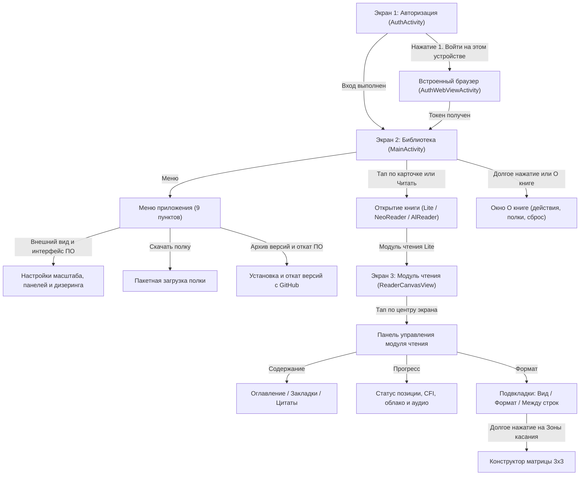

# 📖 Подробное руководство пользователя «Яндекс Книги Lite» (v2.0.0)

> [!TIP]
> **📥 Скачать в формате PDF (для печати и чтения на Onyx Boox):** [**`YandexBooksLite_UserGuide_v2.0.0.pdf`**](YandexBooksLite_UserGuide_v2.0.0.pdf) *(11 страниц A4, со схемами экранов, векторными диаграммами зон касания и таблицами всех кнопок)*.

Настоящее руководство представляет собой полный справочник по **каждому экрану, каждой кнопке, каждому жесту, аппаратной клавише и диалоговому окну** приложения **«Яндекс Книги Lite» v2.0.0** для электронных ридеров **Onyx Boox** и других Android-устройств (Android 4.2.2 – Android 14+).

> [!NOTE]
> **О статусе тестирования и совместимости:** основные сценарии работы, интерфейс, отображение EPUB, синхронизация и откат версий проверены на эмуляторах Android 4.2.2–9.0 с профилями экранов Onyx Boox (`758×1024` и `1072×1448`). На отдельных физических устройствах возможны индивидуальные особенности прошивки — для безопасного перехода между сборками в приложении предусмотрен встроенный **«Архив версий и откат ПО»** (подробности в [разделе 7](#7-файлы-резервное-копирование-ota-обновление-и-откат-по)).

---

## 🗺️ Карта экранов и навигации



---

## 1. Экран входа в аккаунт (`AuthActivity` и `AuthWebViewActivity`)

При первом запуске (или после выхода из аккаунта) открывается экран авторизации. В приложении предусмотрено **5 независимых способов входа** — выберите любой удобный:

```text
+-------------------------------------------------------+
|              Вход в Яндекс Книги                      |
|  [     1. Войти на этом устройстве (Яндекс ID)     ]  |
|-------------------------------------------------------|
|                    [  QR-КОД  ]                       |
|  Интернет-мост: активен | Локальный Wi-Fi: <IP>:8888  |
|  https://ntfy.sh/ybk_xxxxxx                           |
|-------------------------------------------------------|
|  [  Из файла  ]  [ Ввести токен ]  [    Повтор    ]   |
+-------------------------------------------------------+
```

### 1.1. Все кнопки и элементы основного экрана входа

| Элемент / кнопка | Где находится | Что делает при нажатии |
| :--- | :--- | :--- |
| **`1. Войти на этом устройстве (Яндекс ID)`** | Верхняя основная кнопка (с тёмной рамкой) | Открывает встроенный браузер **`AuthWebViewActivity`** прямо на ридере. Не требует компьютера или второго телефона; поддерживает вход по логину/паролю, СМС и QR-коду «Яндекс Ключа». |
| **QR-код и ссылка `https://ntfy.sh/ybk_xxxxxx`** | Центр экрана | **Способ 2 (Облачный мост через интернет, работает даже с мобильной сети 4G/LTE):** отсканируйте QR-код смартфоном, перейдите на страницу `ntfy.sh`, нажмите кнопку уведомления **`1. Нажмите для входа в Яндекс`**, войдите в аккаунт и вставьте полученный адрес обратно в тему `ntfy.sh`. |
| **Строка `Локальный Wi-Fi: http://<IP>:8888`** | Под QR-кодом | **Способ 3 (Локальный Wi-Fi мост):** если ридер и смартфон/ПК находятся в одной сети Wi-Fi, откройте этот локальный адрес в браузере телефона и пройдите авторизацию. *(Без Wi-Fi строка сообщает «Подключите Wi-Fi для работы через смартфон/ПК».)* |
| **`Из файла`** | Левая нижняя кнопка | **Способ 4 (Офлайн через USB):** ищет на накопителе ридера текстовый файл `yandex_token.txt` с токеном вида `y0_...` (поочерёдно проверяет корень памяти устройства, `/sdcard/Download/`, `/sdcard/Books/`, папку приложения и `/mnt/sdcard`). Если файл не найден — показывает подробную памятку. |
| **`Ввести токен`** | Средняя нижняя кнопка | **Способ 5 (Ручной ввод):** открывает окно `Ввод OAuth токена` с инструкцией, ссылкой для браузера (`oauth.yandex.ru`), полем ввода для токена `y0_...` или скопированной после входа ссылки и кнопками **`Сохранить`** / **`Отмена`**. |
| **`Повтор`** | Правая нижняя кнопка | Перезапускает локальный сервер авторизации `:8888`, генерирует новую облачную сессию/QR-код `ntfy.sh` и обновляет статус сети. |

> [!TIP]
> **Аппаратные кнопки на экране входа:** боковые кнопки листания (`PAGE_UP` / `PAGE_DOWN`, `VOLUME_UP` / `VOLUME_DOWN`) плавно прокручивают экран входа вверх и вниз без лишнего мерцания E-Ink.

### 1.2. Встроенный браузер (`AuthWebViewActivity`)

После нажатия `1. Войти на этом устройстве (Яндекс ID)` в самом верху экрана располагается компактная панель помощи для E-Ink и старых версий Android:

| Элемент | Где находится | Назначение |
| :--- | :--- | :--- |
| **`Назад`** | Верхняя панель, крайняя слева | Закрывает встроенный браузер и возвращает на основной экран входа. |
| **`Клавиатура`** | Верхняя панель, вторая слева | Принудительно вызывает системную экранную клавиатуру Android (полезно на прошивках E-Ink, где WebView не всегда поднимает клавиатуру при тапе в поле ввода). |
| **`Ввод текста`** | Верхняя панель, третья слева | Открывает нативное окно ввода текста поверх браузера и аккуратно передаёт введённый логин, пароль или код в активное поле страницы (решает проблему с неотзывчивыми веб-полями на Android 4.2–4.4). |
| **`Обн`** | Верхняя панель, крайняя справа | Перезагружает текущую веб-страницу авторизации и выполняет обновление E-Ink экрана. |
| **Строка подсказки** | Под верхней панелью | Памятка: *«Яндекс Ключ»: наведите на QR или войдите по логину*. |

---

## 2. Главный экран библиотеки (`MainActivity`)

После входа открывается главная страница библиотеки, разделённая на 4 области: **шапка**, **панель вкладок полок** (при необходимости со строкой поиска), **список карточек книг** и **нижний футер навигации**.

```text
+-------------------------------------------------------+
| Яндекс Книги Lite     [ Lite ]  [Обновить]*  [ Меню ] |
+-------------------------------------------------------+
| Читаю(N) | В планах(N) | Файлы(N) | Каталог | Поиск  |
+-------------------------------------------------------+
| (При активной вкладке Поиск: [Название/автор] [Найти])|
+-------------------------------------------------------+
| [Обложка]  Название книги                             |
|            Автор                [Читать]  [О книге]   |
|            [====-----] 42% • В памяти                 |
+-------------------------------------------------------+
| Читаю: 12 • v2.0.0         [< Стр]   1/4   [Стр >]    |
+-------------------------------------------------------+
* Кнопка [Обновить] в шапке появляется автоматически, если на GitHub вышел новый релиз.
```

### 2.1. Шапка главного экрана

| Кнопка / элемент | Короткое нажатие | Долгое нажатие |
| :--- | :--- | :--- |
| **`Яндекс Книги Lite`** | Информационный заголовок приложения. | — |
| **Переключатель режима чтения** (`Lite` / `NeoReader` / `AlReader` / `Выбор`) | Циклически переключает активную программу чтения по кругу: **`Lite` → `NeoReader` → `AlReader` → `Выбор`**. Текущий выбранный режим сохраняется в настройках. | Открывает диалог **`Выбор основного приложения для чтения`**, где можно сразу выбрать нужный пункт из списка без прокликивания по кругу (`Модуль чтения Lite`, `Onyx NeoReader`, `AlReader`, `Спрашивать каждый раз`). |
| **`Обновить`** *(скрыта по умолчанию)* | Появляется только при обнаружении новой версии ПО на GitHub. Открывает окно загрузки и установки обновления. | — |
| **`Меню`** | Открывает окно **`Меню приложения`** (см. [раздел 3.2](#32-окно-меню-приложения)). | — |

### 2.2. Панель вкладок полок

| Вкладка | Что отображает | Особенности |
| :--- | :--- | :--- |
| **`Читаю (N)`** | Книги с текущей активной полки чтения и локально сохранённый счётчик `N`. | Синхронизируется с Яндекс Книгами автоматически при входе и по кнопке `Синхронизация`. |
| **`В планах (N)`** | Отложенные книги из облачного списка «Буду читать». | При открытии любой книги с этой полки через кнопку `Читать` она автоматически переносится на полку `Читаю`. |
| **`Файлы (N)`** | Раздел **`user_books` («Мои файлы»)** — личные книги (`EPUB`/`FB2`), загруженные пользователем в свой профиль Яндекс Книг / Букмейта. | Поддерживает скачивание на устройство, чтение и синхронизацию прогресса так же, как библиотечные книги. |
| **`Каталог`** | Рекомендации и подборки Яндекс Книг (доступен при подключённом интернете). | Позволяет находить новые книги и добавлять их на полки через `О книге` или `Читать`. |
| **`Поиск`** | Открывает под вкладками поле ввода (`Название книги или автор...`) и кнопку **`Найти`**. | Работает по нажатию `Найти` или клавиши `Enter`/лупы на экранной клавиатуре. |

> [!NOTE]
> Если текущая полка пуста или отсутствует интернет на вкладках `Каталог`/`Поиск`, по центру отображается информационная заглушка и контекстная кнопка действия: **`Обновить список книг`**, **`Обновить «Мои файлы»`**, **`Обновить каталог`**, **`Повторить попытку`**, **`Повторить поиск`** или **`Очистить поиск`**.

### 2.3. Карточка книги (`item_book`)

| Зона карточки | Короткое нажатие | Долгое нажатие |
| :--- | :--- | :--- |
| **Общая область карточки** (обложка, название, автор, шкала прогресса и статус `• В памяти` / `• Онлайн`) | Запускает загрузку файла (если книга ещё `• Онлайн`) и сразу открывает книгу в выбранной программе чтения. | Открывает подробное окно **`О книге`** (см. [раздел 3.1](#31-окно-о-книге)). |
| **Кнопка `Читать`** | Скачивает книгу (если нужно) и немедленно открывает её для чтения. Книга с полки `В планах` переносится в `Читаю`. | — |
| **Кнопка `О книге`** | Открывает карточку свойств и действий книги (**`О книге`**). | — |

> Обложки книг проходят опциональную диффузную обработку **Флойда–Стейнберга** для 16 градаций серого на E-Ink, что убирает грубые цветовые полосы при перерисовке списка.

### 2.4. Нижний футер библиотеки и аппаратные клавиши

| Элемент | Действие |
| :--- | :--- |
| **`< Стр`** | Пролистывает список книг на **3 карточки вверх** с очисткой E-Ink. |
| **Индикатор страниц `1/N`** *(или `0/0` если пусто)* | Показывает текущую страницу списка книг из общего числа (по 3 карточки на страницу). |
| **`Стр >`** | Пролистывает список книг на **3 карточки вниз** с очисткой E-Ink. |
| **Статус слева** *(например, `Читаю: 12 • v2.0.0`)* | Отображает активную полку, число книг на ней и текущую версию ПО. **Скрытая функция:** нажатие на эту строку запускает **принудительную ручную проверку обновлений** на GitHub. |
| **Боковые физические кнопки** (`PAGE_DOWN`/`VOLUME_DOWN` и `PAGE_UP`/`VOLUME_UP`, а также `DPAD`) | Листают список книг по страницам вверх/вниз и прокручивают открытые диалоги. |

---

## 3. Диалоги главного экрана

### 3.1. Окно «О книге»

Вызывается кнопкой **`О книге`** или долгим нажатием на карточку книги. Содержит название, автора, строку состояния (`Прогресс: XX% [• Не синхр.] • Статус: В памяти / В сети`) и прокручиваемую аннотацию книги (управляется в том числе боковыми кнопками листания).

Ниже расположены ряды управляющих кнопок:

| Ряд | Кнопки | Назначение |
| :--- | :--- | :--- |
| **1. Открыть с помощью** | **`[ NeoReader ]`** · **`[ AlReader ]`** · **`[ Ридер Lite ]`** | Открывает именно эту книгу напрямую в выбранной программе чтения без изменения глобального режима в шапке. |
| **2. Полка** | **`[ Читаю ]`** · **`[ В планы ]`** · **`[ Прочитано ]`** | Перемещает книгу на выбранную полку (активная полка помечена точкой **`• `**) и синхронизирует статус с облаком Яндекса. |
| **3. Память и прогресс** | **`[ Скачать ]`** *(или **`[ Удалить ]`**, если книга уже в памяти)* и **`[ Сбросить ]`** | `Скачать` загружает файл книги (EPUB/FB2) на устройство в офлайн-кэш; `Удалить` очищает только локальный файл (книга остаётся на полке в сети). `Сбросить` обнуляет прогресс чтения этой книги после подтверждения. |
| **Доп. кнопка** *(видима при наличии локального прогресса, не ушедшего на сервер)* | **`Синхронизировать прогресс с облаком`** | Отправляет накопленный локальный прогресс этой книги на сервер Яндекс Книг и обновляет статус. |
| **4. Завершение** | **`[ Убрать ]`** · **`[ Закрыть ]`** | `Убрать` запрашивает подтверждение и полностью удаляет книгу и из библиотеки профиля, и с устройства. `Закрыть` закрывает диалог. |

### 3.2. Окно «Меню приложения»

Вызывается кнопкой **`Меню`** в правом верхнем углу. В правом верхнем углу заголовка также есть кнопка быстрого закрытия **`X`**. Список пунктов прокручивается (включая аппаратные клавиши листания):

| № | Пункт меню | Что делает |
| :---: | :--- | :--- |
| 1 | **`Прочитано (N)`** | Переключает главный экран на список прочитанных книг. |
| 2 | **`Мои файлы (N)`** | Открывает вкладку **`Файлы`** (`user_books`) с личными книгами аккаунта. |
| 3 | **`Скачать полку`** | Запускает окно пакетной загрузки книг текущей полки (см. [раздел 3.4](#34-пакетная-загрузка-скачать-полку)). Доступна на полках `Читаю`, `В планах` и `Прочитано`. |
| 4 | **`Синхронизация`** | Принудительно отправляет накопившуюся офлайн-очередь изменений (`sync_queue`) и обновляет данные текущей полки с облаком. |
| 5 | **`Внешний вид и интерфейс ПО`** | Открывает мастер настройки масштаба UI (`100%–200%`), размеров панелей, отступа часов и дизеринга обложек (см. [раздел 3.3](#33-внешний-вид-и-интерфейс-по)). |
| 6 | **`Обновление ПО`** | Проверяет наличие новой версии на GitHub и при её наличии предлагает скачать и установить APK. |
| 7 | **`Архив версий и откат ПО`** | Загружает с GitHub список всех релизов с метками `[ТЕКУЩАЯ]`, `[НОВАЯ]`, `[ОТКАТ]` и позволяет установить любую прошлую или новую версию. |
| 8 | **`Очистить экран`** | Выполняет принудительную полную перерисовку E-Ink контроллера (`GC16`) для снятия остаточных артефактов («гостинга»). |
| 9 | **`Выйти из аккаунта`** | Выводит окно подтверждения (`Выйти` / `Отмена`), очищает токен и возвращает на экран авторизации. |

Под прокручиваемым списком указана версия (`Яндекс Книги Lite v2.0.0`) и две нижние кнопки:
* **`Свернуть меню`** — закрывает меню и остаётся в библиотеке.
* **`Выйти из ПО`** — полностью завершает работу приложения.

### 3.3. Окно «Внешний вид и интерфейс ПО»

Позволяет настроить геометрию интерфейса под экраны от 6" (758×1024, утопленные рамки Darwin) до 10.3"–13.3" (300 DPI):

| Секция | Элементы управления | Назначение |
| :--- | :--- | :--- |
| **1. Панели и кнопки** | **`Компактный`** · **`Оптим. (Darwin)`** · **`Крупный`** · **`Максимум`** | Задаёт высоту шапки, вкладок полок, футера и элементов меню библиотеки. |
| **2. Карточки книг и кнопки на полке** | **`Комп.`** · **`Стандарт`** · **`Крупные`** | Регулирует высоту обложки, размер шрифта заголовка и кнопок `Читать` / `О книге` на главной полке. |
| **3. Отступ часов/заряда в модуле чтения (от бортика)** | **`- 4 dp`** · значение `<X> dp` · **`+ 4 dp`** | Регулирует безопасный отступ нижнего колонтитула в книге шагами по `4 dp` (диапазон от `6` до `48 dp`). Полезно для моделей с глубоко утопленной рамкой экрана (например, Darwin 1–5). |
| **4. Общий масштаб и графика** | **`Масштаб ОС: <X>% (выбрать...)`** | Открывает выбор из 7 ступеней масштаба всего интерфейса и диалогов ПО: **`100%`**, **`115%`**, **`130%`**, **`145%`**, **`160%`**, **`180%`**, **`200%`**, а также переключатель **`Дизеринг обложек (E-Ink 16 градаций): Вкл / Выкл`** и **`Отмена`**. При выборе `115%–200%` главный экран сразу перерисовывается с новым масштабом. |
| **5. Сброс и сохранение** | **`Сбросить визуал по умолчанию (Darwin)`** и **`Готово`** | Кнопка сброса возвращает стандартные параметры под 6" экран Darwin (`Оптим.`, `Стандарт`, `16 dp`, `100%`); `Готово` сохраняет и закрывает окно. |

### 3.4. Пакетная загрузка («Скачать полку»)

Показывает количество книг к загрузке из общего числа на полке:
* Если не все книги скачаны: доступны кнопки **`Скачать недостающие (N)`**, **`Скачать всю полку заново (M)`** (если часть уже в памяти) и **`Отмена`**.
* Если вся полка уже скачана: доступны **`Перекачать все книги (M)`** и **`Закрыть`**.
* Во время скачивания отображается прогресс-бар и текущее название книги; кнопка `Отмена` меняется на **`Остановить`** (после остановки — **`Закрыть`**).

---

## 4. Экран 3: Модуль чтения Lite (`ReaderActivity`)

Встроенный модуль чтения рисует книгу напрямую на нативном `Canvas` без браузерного движка, благодаря чему потребляет минимум памяти и поддерживает гибридное EPUB-форматирование (заголовки `h1`–`h6`, абзацы, отбивки, цитаты с вертикальной линией, **жирный**, *курсив*, подчёркивание, зачёркивание, моноширинные вставки и иллюстрации с дизерингом).

### 4.1. Приоритет касаний, жестов и свайпов на странице

Чтобы жесты никогда не конфликтовали между собой, экран чтения обрабатывает прикосновения в строгом порядке приоритета:

1. **Регулировка подсветки по краям экрана** *(если включена в настройках)*:
   * Проведите пальцем **вертикально вверх/вниз** вдоль **самой узкой кромки** экрана (`20 dp`, не менее `24 px`):
     * **Левый край** регулирует **тёплую подсветку** (на E-Ink с двумя тонами подсветки).
     * **Правый край** регулирует **холодную подсветку** (или основную яркость).
   * На экране появляется лаконичное окно **`Тёплый свет: X%`** / **`Холодный свет: X%`**. Короткое касание по тому же краю не считается свайпом и работает как обычная зона перелистывания.
2. **Долгое нажатие — выделение слов, цитаты и заметки**:
   * Удерживайте палец на слове до появления рамки выделения и, не отрывая палец, проведите до конца нужного фрагмента.
   * После отпускания откроется окно **`Выделенный фрагмент`** с 4 кнопками:
     * **`Сохранить цитату`** — сохраняет цитату локально (с мягким выделением в тексте), ставит в очередь синхронизации и отправляет в облако Яндекс Книг.
     * **`Сохранить с заметкой`** — открывает диалог **`Заметка к цитате`** с полем ввода и кнопками **`Сохранить`** / **`Отмена`**.
     * **`Копировать текст`** — копирует выделенный фрагмент в системный буфер обмена Android.
     * **`Отмена`** — снимает выделение без сохранения.
3. **Горизонтальный свайп** *(смещение по горизонтали `>= 35 px` и больше вертикального)*:
   * Свайп **справа налево** (`<--`) — **следующая страница**.
   * Свайп **слева направо** (`-->`) — **предыдущая страница**.
4. **Кликабельные сноски и гиперссылки** *(при коротком нажатии без смещения, до срабатывания тап-зон)*:
   * Нажатие на маркер сноски (например, `[1]`, `*`) или внутреннюю ссылку EPUB открывает **всплывающее окно с текстом примечания — ваша текущая страница книги при этом не теряется**.
   * Нажатие на внешнюю ссылку (`http://`, `https://`, `mailto:`) выводит диалог **`Внешняя ссылка`** с кнопками **`Открыть в браузере`** и **`Отмена`**.
5. **Тап по зонам экрана**: срабатывает, если касание длилось менее `700 мс` и не попало в сноску или ссылку.

### 4.2. Профили зон касания экрана

| Режим | Левая часть | Центр | Правая часть |
| :--- | :--- | :--- | :--- |
| **`Стандарт`** | Левые 30%: **Назад** | Средние 40%: **Меню** | Правые 30%: **Вперёд** |
| **`Для левшей`** | Левые 35%: верхние 30% и нижние 30% = **Вперёд**, середина (40%) = **Назад** | Центр 35%: **Меню** | Правые 30%: **Вперёд** |
| **`Верх / Низ`** | Верхние 30% всей ширины: **Назад** | Средние 30% высоты: **Меню** | Нижние 40% всей ширины: **Вперёд** |
| **`Своя 3×3`** | Настраивается (шаблоны «Правша» / «Левша» или своё действие в левых 3 ячейках) | Настраивается (центральные 3 ячейки матрицы `3×3`) | Настраивается (правые 3 ячейки матрицы `3×3`) |

### 4.3. Аппаратные клавиши и нижний колонтитул

* **Физические кнопки сбоку** (`PAGE_UP`/`PAGE_DOWN`, `VOLUME_UP`/`VOLUME_DOWN`, кнопки Onyx `92/93`, `166/167`, `260/261`):
  * **Короткое нажатие:** листает страницу вперёд или назад. Системное всплывающее окно громкости `VolumePanel` полностью заблокировано.
  * **Долгое удержание кнопки перелистывания:** принудительная глубокая очистка всего экрана (`GC16`).
  * В закрытых списках (выбор шрифта, оглавление) эти же кнопки перемещают фокус/прокручивают список.
* **Системная кнопка «Назад»** на корпусе: если открыто оверлейное меню чтения — закрывает его; если открыта книга — сохраняет прогресс, сбрасывает очередь синхронизации и возвращает в библиотеку.
* **Нижний колонтитул книги:** слева — текущее время и заряд батареи (`ЧЧ:ММ • XX%`), справа — **сквозная нумерация по всей книге** (`Стр. X из Y (Z%)`), рассчитанная по дисковому кэшу страниц `page_counts.json`.

---

## 5. Панели управления и все настройки модуля чтения

При нажатии на **центральную зону** открываются верхняя и нижняя панели управления. Повторное нажатие на текст, кнопку `X` или системную кнопку `Назад` скрывает панели.

```text
+-------------------------------------------------------+
| [<]        Название читаемой книги       [Сброс]  [X] |
+-------------------------------------------------------+
|                                                       |
|                  (Текст книги)                        |
|                                                       |
+-------------------------------------------------------+
| Текущая глава                               [<<] [>>] |
| [<]  ===========O-------------------------- [>] 42/320|
+-------------------------------------------------------+
| [   Содержание   ]  [   Прогресс   ]  [   Формат   ]  |
+-------------------------------------------------------+
```

### 5.1. Верхняя панель и навигатор глав/страниц

| Элемент | Где находится | Действие |
| :--- | :--- | :--- |
| **`<`** | Верхняя панель, слева | Сохраняет текущий прогресс, запускает отправку очереди в облако и возвращает на главный экран библиотеки. |
| **Название книги** | Верхняя панель, центр | Информационный заголовок открытой книги. |
| **`Сброс`** | Верхняя панель, справа от названия | Выполняет полную очистку E-Ink матрицы (`GC16`), убирая любые следы предыдущего текста. |
| **`X`** | Верхняя панель, справа | Скрывает панели управления, оставляя только книгу. |
| **`<<`** и **`>>`** | Справа от названия текущей главы | Переход к предыдущей (`<<`) или следующей (`>>`) главе книги. На первой/последней главе показывают уведомление. |
| **`<`**, **ползунок**, **`>`** | Нижняя панель навигации | Быстрое перемещение по страницам текущей главы: кнопки `<` / `>` сдвигают на 1 страницу с перелистыванием, ползунок — на произвольную страницу. Справа отображается счётчик. |

### 5.2. Вкладка «Содержание» (`Оглавление`, `Закладки`, `Цитаты`)

Нажатие на **`Содержание`** открывает окно с тремя переключаемыми вкладками вверху:

| Подвкладка | Содержимое и кнопки |
| :--- | :--- |
| **`Оглавление (N)`** | Иерархический список глав EPUB/FB2 (многоуровневые вложенные главы поддерживают сворачивание/разворачивание; текущая глава подсвечена). Тап по главе сразу переносит на её начало. |
| **`Закладки (N)`** | Вверху кнопка **`+ Добавить текущую страницу в закладки`**. Ниже — список сохранённых закладок с процентом и номером главы. Тап по закладке переносит на страницу; кнопка **`X`** справа удаляет закладку. |
| **`Цитаты (N)`** | Вверху кнопка **`Экспорт цитат в файл (.md)`**, которая сохраняет все цитаты и заметки книги в готовый Markdown-файл в папке `/sdcard/Books/YandexBooks/Quotes/`. Ниже — карточки цитат (с текстом заметки, если она добавлена). Тап по цитате открывает её страницу; кнопка **`X`** справа удаляет цитату. |

Внизу окна расположена кнопка **`Закрыть`**. Во время просмотра длинного оглавления или закладок работают физические кнопки листания страниц корпуса.

### 5.3. Вкладка «Прогресс»

Открывает карточку состояния текущей позиции книги:
* Показывает текущую главу, страницу в главе, сквозную страницу и процент, канонический идентификатор **EPUB CFI** и статус синхронизации с облаком.
* Кнопка **`Синхронизировать`** — принудительно сверяет и отправляет текущую позицию с облаком Яндекс Книг.
* **Блок аудиоверсии** *(появляется только в том случае, если у читаемой книги в сервисе Яндекса есть связанная аудиокнига)*: отображает позицию аудио и позволяет вручную подтянуть позицию между аудио и текстом.
* Кнопка **`Закрыть`** — закрывает диалог.

### 5.4. Вкладка «Формат» — все 3 подвкладки и каждая кнопка

Нажатие **`Формат`** открывает или сворачивает выдвижную панель настроек прямо над нижними вкладками. Для удобства попадания на E-Ink нажимать можно не только на правую кнопку значения, но и **на всю строку целиком**.

#### Подвкладка 1: «Вид»

| Строка / кнопка | Доступные значения и поведение |
| :--- | :--- |
| **`Размер шрифта`** | Кнопки **`—`** (уменьшить на 1 pt) и **`+`** (увеличить на 1 pt), ползунок и индикатор справа. Допустимый диапазон: **от `12` до `36`**. |
| **`Вид шрифта`** | Открывает окно **`Выбор шрифта для чтения`** с 8 оптимизированными шрифтами: **`Literata`**, **`Charis SIL`**, **`PT Serif`**, **`PT Sans`**, **`Inglobal`**, **`Системный Serif`**, **`Системный Sans`**, **`Моноширинный`**. *(Находясь в этом окне, можно перебирать шрифты аппаратными кнопками листания вверх/вниз и подтверждать выбор центральной кнопкой `Enter`/`D-Pad Center`.)* |
| **`Абзацный отступ`** | Циклически переключает величину красной строки: **`0 px`** → **`20 px`** → **`32 px`** → **`44 px`**. |
| **`Зоны касания экрана`** | **Короткое нажатие:** открывает диалог выбора режима (`Стандарт`, `Для левшей`, `Верх / Низ`, `Пользовательская сетка 3×3`) + кнопка **`Настроить сетку 3×3`**. **Долгое нажатие на кнопку:** сразу открывает конструктор сетки `3×3` (см. [раздел 5.5](#55-конструктор-сетки-касаний-33)). |
| **`Подсветка по краям`** | Переключает жесты подсветки у краёв экрана: **`Свайп (Вкл)`** / **`Выключена`**. |
| **`Полный экран`** | Переключает скрытие верхней системной строки состояния Android (часы/иконки ОС) во время чтения: **`Выкл`** / **`Скрыт бар`**. |
| **`Синхр. с аудио`** *(видима только для книг со связанной аудиоверсией)* | Переключает поведение при обнаружении более новой аудиопозиции: **`Спрашивать`** / **`Выключена`**. |

#### Подвкладка 2: «Формат»

| Строка / кнопка | Доступные значения и поведение |
| :--- | :--- |
| **`Жирность текста`** | **`Обычный`** / **`Жирный`** — повышает толщину штриха на экранах с невысокой контрастностью E-Ink. |
| **`Переносы слов (TeX)`** | **`Включены`** / **`Отключены`** — автоматическая расстановка мягких переносов русского и английского языка по алгоритму Лянга–Кнута. |
| **`Контраст E-Ink`** | **`Обычный`** / **`Высокий`** — максимально чёрное начертание букв и чёткое сглаживание контуров. |
| **`Цветовая тема`** | **`Светлая`** (чёрный текст на белом фоне) / **`Тёмная`** (белый текст на чёрном фоне для чтения в темноте без подсветки). |
| **`Шрифт книги (EPUB)`** | **`Из настроек`** (используется выбранная гарнитура из списка 8 шрифтов) / **`Из EPUB`** (применяет встроенные шрифты `.ttf`/`.otf` из самого файла книги, если они присутствуют в EPUB; если их нет — выводит информационное уведомление). |

#### Подвкладка 3: «Между строк»

| Строка / кнопка | Доступные значения и поведение |
| :--- | :--- |
| **`Межстрочный интервал`** | Цикл: **`1.00x`** → **`1.25x`** → **`1.50x`** → **`1.75x`**. |
| **`Боковые поля (Л/П)`** | Цикл левого и правого отступа: **`Сверх-узкие (8)`** → **`Узкие (18)`** → **`Средние (32)`** → **`Широкие (48)`**. |
| **`Верх/низ поля`** | Цикл верхнего и нижнего отступа текста: **`Малые`** → **`Стандарт`** → **`Большие`**. |
| **`Отступ снизу (часы)`** | Цикл отступа нижнего колонтитула от края матрицы: **`8 dp (Малый)`** → **`16 dp (Darwin)`** → **`24 dp (Крупный)`** → **`32 dp (Макс.)`** → **`40 dp (Макс.)`**. *(Пошаговая точная настройка шагами по `4 dp` также доступна в разделе `Меню → Внешний вид и интерфейс ПО`.)* |
| **`Ориентация`** | Циклический поворот страницы: **`Портрет`** → **`Ландшафт`** → **`Обр. ландшафт`**. |

### 5.5. Конструктор сетки касаний `3×3`

Открывается из окна выбора зон касания по кнопке **`Настроить сетку 3×3`** или **долгим нажатием** на кнопку `Зоны касания экрана` на подвкладке `Вид`.

* На экране отображается таблица из **9 кнопок** (`3 ряда × 3 столбца`).
* Каждое нажатие на отдельную ячейку меняет её действие по циклу из **7 вариантов**:
  1. **`Вперед →`** — следующая страница
  2. **`← Назад`** — предыдущая страница
  3. **`Меню`** — открыть/скрыть панели чтения
  4. **`Оглавл.`** — сразу открыть окно «Содержание»
  5. **`Закладка`** — мгновенно поставить/удалить закладку на текущей странице
  6. **`Обновить`** — принудительная перерисовка E-Ink экрана (`GC16`)
  7. **`Пусто`** — отключить нажатие в этой ячейке (удобно, чтобы не задевать экран пальцем, держащим ридер)
* Под сеткой находятся кнопки быстрой настройки и сохранения:
  * **`Шаблон: Правша`** и **`Шаблон: Левша`** — заполняют все 9 ячеек готовой раскладкой в одно касание.
  * **`Сохранить и включить 3×3`** — сохраняет матрицу и сразу делает её активным режимом тап-зон.
  * **`Отмена`** — закрывает конструктор без сохранения.

---

## 6. Синхронизация и внешние программы чтения (`NeoReader` / `AlReader`)

* **Точность позиций и многотомники:** модуль чтения Lite отправляет и принимает позиции через мобильный GraphQL Gateway с вычислением канонического **EPUB CFI** по таблице `spine` / `idref` внутри `OPF`-файла книги. Это обеспечивает точное совпадение места чтения даже в многотомных сборниках и омнибусах со смартфоном и другими устройствами.
* **Офлайн-очередь (`sync_queue`):** если вы читаете без Wi-Fi, прогресс, полки и закладки/цитаты сохраняются в локальную очередь SQLite и автоматически досылаются при появлении сети или по кнопке **`Меню → Синхронизация`**.
* **Внешние программы чтения (`NeoReader` / `AlReader`):** файлы передаются через защищённый **`LocalFileProvider`** (`content://` URI), благодаря чему передача книг работает без сбоев на всех версиях Android вплоть до Android 14+. При старте и выходе из внешнего ПО приложение учитывает время чтения и запрашивает доступный серверный прогресс.

---

## 7. Файлы, резервное копирование, OTA-обновление и откат ПО

### 7.1. Какие папки на накопителе использует приложение

| Путь на накопителе ридера | Назначение |
| :--- | :--- |
| **`/sdcard/Books/YandexBooks/backup/`** | Автоматическая резервная копия локальной базы данных `yandex_books_lite.db`, токена авторизации и **21 настройки** интерфейса и типографики. |
| **`/sdcard/Books/YandexBooks/Quotes/`** | Файлы Markdown (`.md`) с экспортированными цитатами и заметками к книгам. |
| **`/sdcard/Books/`** и **`/sdcard/Download/`** | Поиск файла токена `yandex_token.txt` (также проверяется корень памяти `/sdcard/`). Скачанные через OTA/Архив установочные пакеты `.apk` регистрируются в системных «Загрузках» Android. |

### 7.2. Проверка обновлений и откат через «Архив версий»

1. Откройте **`Меню → Обновление ПО`** (или нажмите на строку статуса в самом низу главной библиотеки, например `Читаю: 12 • v2.0.0`).
2. Для возврата на прошлую версию откройте **`Меню → Архив версий и откат ПО`**. Каждая строка архива помечена тегом **`[ТЕКУЩАЯ]`**, **`[НОВАЯ]`** или **`[ОТКАТ]`** и точным размером `.apk`.
3. Нажмите нужную версию, подтвердите установку и следуйте стандартному системному установщику Android (при необходимости удаления текущей версии перед понижением номера версии следуйте подсказке диалога).

> [!WARNING]
> **Важные правила при удалении ПО и откате версии:**
> * **Скачанные файлы книг (`.epub`/`.fb2`):** хранятся во внутреннем защищённом кэше приложения — при полном удалении APK ради понижения версии операционная система Android очищает эту папку, и нужные книги потребуется повторно скачать с полки (достаточно нажать `Меню → Скачать полку`).
> * **Токен входа, база данных и 21 настройка:** автоматически сохраняются и восстанавливаются при переходе между сборками с поддержкой автобэкапа (`1.6.3+` и `2.0.0`).
> * **Откат на версию `v1.6.0`:** так как в `v1.6.0` система автоматического резервного копирования в `/sdcard/Books/YandexBooks/backup/` ещё не поддерживалась, после отката на `v1.6.0` потребуется **повторно войти в аккаунт**, **заново скачать локальные книги** и **заново выставить настройки ПО**.
