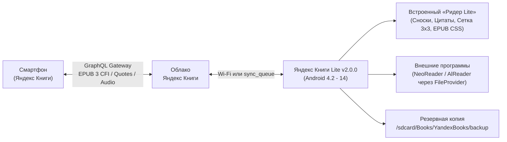

# 📖 Подробное руководство пользователя «Яндекс Книги Lite» (v2.0.0 Stable Release)

Добро пожаловать в **«Яндекс Книги Lite»** — специализированный клиент сервиса «Яндекс Книги» для электронных книг **Onyx Boox** (Darwin 1–7, Livingstone, Faust, Vasco da Gama, Monte Cristo, Poke, Leaf, Page, Palma, Nova, Note, Tab, Go 10.3), Bigme B6 и других устройств на базе **Android 4.2.2 – Android 14+** с экранами E-Ink Carta и Carta Plus.

Приложение спроектировано специально для физики электронных чернил: сверхнизкое потребление памяти (15–20 МБ RAM), отсутствие мерцающих анимаций, высококонтрастный чёрно-белый интерфейс, перехват физических кнопок, нативный книжный рендеринг EPUB, работа с цитатами и сквозная двусторонняя синхронизация с мобильным приложением на смартфоне.

---

## 1. Вход в аккаунт (без ввода пароля на ридере)

Набирать сложный пароль на экране E-Ink неудобно, поэтому используется безопасный вход через официальный протокол Яндекс ID (**OAuth Device Flow RFC 8628**) при помощи смартфона:

1. Включите **Wi-Fi** на устройстве и запустите **«Яндекс Книги Lite»**.
2. На экране появятся **контрастный QR-код** и **8-значный код** для ввода вручную.
3. **Способ A (быстрый):** отсканируйте QR-код камерой смартфона и подтвердите вход в открывшейся странице Яндекс ID.
4. **Способ B (ручной):** откройте в браузере телефона или компьютера сайт **`ya.ru/device`**, введите 8-значный код и подтвердите авторизацию.
5. Через 2–3 секунды ридер автоматически войдёт в ваш профиль, подхватит активную подписку и загрузит книжные полки.

> [!TIP]
> Если на устройстве остались локальные книги и резервная копия от предыдущей установки (`1.6.1+`), настройки интерфейса, база и сессия подтянутся автоматически при первом запуске.

---

## 2. Главный экран: Библиотека и управление полками

Интерфейс библиотеки перерисовывается постранично без плавной прокрутки — это полностью исключает размытие и серый «мусор» на матрице E-Ink.

### Верхняя панель управления
* **Название («Яндекс Книги Lite»):** заголовок библиотеки.
* **Кнопка выбора режима чтения (`NeoReader` / `AlReader` / `Выбор` / `Lite`):**
  * Короткое нажатие циклически переключает программу чтения по умолчанию: **`Lite`** $\to$ **`NeoReader`** $\to$ **`AlReader`** $\to$ **`Выбор`**.
  * **Долгое нажатие** открывает окно быстрого выбора нужного режима.
  * Кнопка **`Книга в Lite` / `Lite`** (рекомендуется): открывает книги во встроенном «Ридере Lite» с полноценной двусторонней синхронизацией глав, абзацев и цитат.
  * Режим **`NeoReader`** или **`AlReader`**: открывает EPUB во внешней установленной программе чтения Onyx или AlReader (с автоматическим обходом ограничений Android 7–14 через защищённый `LocalFileProvider`). Если AlReader не установлен, приложение откроет системный выбор приложений без скрытой подмены на NeoReader.
* **Кнопка обновления (появляется при выходе новой версии):** показывает тег свежего релиза на GitHub и сразу открывает окно загрузки по воздуху.
* **Кнопка `Меню`:** открывает главное меню приложения.

### 5 основных вкладок полки
1. **`Читаю (N)`** — книги, которые вы читаете сейчас. Карточка показывает процент прочитанного (`XX%`) и статус **`В памяти`** (если книга уже скачана на устройство для чтения без интернета).
2. **`В планах (N)`** — книги, отложенные на будущее в вашем аккаунте.
3. **`Файлы (N)`** — ваша личная полка пользовательских книг (**User Uploads**), загруженных вами в сервис Яндекс Книги / Букмейт. Книги поддерживают скачивание, офлайн-чтение и синхронизацию прогресса.
4. **`Каталог`** — подборки, новинки и рекомендации сервиса (доступно при включённом Wi-Fi).
5. **`Поиск`** — поиск по библиотеке сервиса по названию или автору (доступно при включённом Wi-Fi).

### Управление книгой и карточка «О книге»
* **Короткое нажатие по карточке книги (или кнопка `Читать`):** мгновенно открывает книгу в выбранном режиме чтения (если файла ещё нет в памяти, он автоматически скачивается).
* **Кнопка `О книге` (или долгое нажатие на карточку):** открывает информационную карточку произведения:
  * Полная аннотация с постраничной прокруткой.
  * Статус прогресса, метка **`• Не синхр.`** (если чтение велось офлайн) и статус файла (**`В памяти`** / **`В сети`**).
  * **Три прямые кнопки запуска:** **`[ NeoReader ]`**, **`[ AlReader ]`**, **`[ Ридер Lite ]`**. Выбор любой кнопки автоматически переносит книгу на полку «Читаю», если она находилась в планах.
  * **Управление полками:** быстрый перенос на полки `[ Читаю ]`, `[ В планах ]`, `[ Прочитано ]`.
  * **`Скачать` / `Удалить файл`:** заранее загружает книгу в память без переноса её на полку «Читаю», либо удаляет локальный файл с устройства для экономии памяти (прогресс в облаке не теряется).
  * **`Сбросить`:** обнуляет прогресс книги, очищает локальные закладки и возвращает книгу на полку «В планах».
  * **`Убрать`:** удаляет книгу с вашей облачной полки и стирает локальный файл.

### Нижняя панель перелистывания списка (Footer)
* **Слева:** текущая полка, количество книг и установленная версия (например, *«Читаю: 12 • v2.0.0»*).
  * *Секретная функция:* короткое нажатие по этой строке мгновенно запускает проверку обновлений ПО на GitHub!
* **Справа:** кнопки **`< Стр`** и **`Стр >`** и счётчик страниц **`1/5`**. Нажатие на индикатор страниц открывает быстрый переход на нужную страницу списка, а физические боковые кнопки устройства также листают список книг.

---

## 3. Главное меню и настройка интерфейса ПО

При нажатии на **`Меню`** открывается прокручиваемый список системных инструментов:

1. **`Прочитано (N)`** — список полностью завершённых книг.
2. **`Мои файлы (N)`** — быстрый переход ко всем загруженным вами пользовательским файлам.
3. **`Скачать полку`** — пакетная загрузка всех нескачанных книг текущей полки одним нажатием с индикатором хода загрузки по каждой книге.
4. **`Синхронизация`** — принудительная выгрузка всей офлайн-очереди на сервер Яндекса и загрузка свежих полок и прогресса со смартфона.
5. **`Внешний вид и интерфейс ПО`** — гибкая настройка отображения интерфейса под любую диагональ от 6" (Darwin 1–7) до 10.3" (Go 10.3, Note, Tab):
   * **Панели и кнопки:** `Компактный` / `Оптим. (Darwin)` / `Крупный` / `Максимум` — регулирует высоту шапки, вкладок и нижней панели.
   * **Карточки книг на полке:** `Комп.` / `Стандарт` / `Крупные`.
   * **Отступ часов/заряда в модуле чтения (от бортика):** регулировка кнопками `- 4 dp` / `+ 4 dp` в диапазоне `6–48 dp`. Поднимает нижний колонтитул выше пластиковой рамки корпуса (актуально для Darwin 5 и других утопленных экранов).
   * **Масштаб ОС:** 7 ступеней глобального увеличения шрифтов и диалогов — **`100%`**, **`115%`**, **`130%`**, **`145%`**, **`160%`**, **`180%`** (для 10.3") и **`200%`** (максимальный для 10.3" 300 PPI).
   * **Дизеринг обложек (E-Ink 16 градаций):** включает/отключает полутоновой диффузный дизеринг Флойда–Стейнберга для гладкой отрисовки обложек и иллюстраций без цветовых «ступенек».
   * Кнопка **`Сбросить визуал по умолчанию (Darwin)`** — мгновенно возвращает оптимальные настройки.
6. **`Обновление ПО`** — ручная проверка выхода новых стабильных сборок на GitHub.
7. **`Архив версий и откат ПО`** — загрузка списка до 50 релизов проекта, просмотр описания и безопасная переустановка другой сборки (подробнее см. раздел 7).
8. **`Очистить экран`** — принудительное полное обновление E-Ink (удаляет остаточные фантомы изображения).
9. **`Выйти из аккаунта`** — выход из Яндекс ID (с подтверждением).

---

## 4. Встроенный модуль чтения «Ридер Lite»

«Ридер Lite» рисует страницы напрямую на нативном `Canvas`, не используя браузерный движок Android. Это гарантирует мгновенный отклик и чёткость шрифта на 300 DPI.

### 4.1. Аппаратные клавиши и жесты подсветки
* **Боковые клавиши листания:** поддерживаются все коды клавиш Onyx (`92/93`, `104/109`, `166/167`, `260/261`, `Page Up/Down`, `Volume Up/Down`). Системный ползунок громкости **полностью заблокирован**. Встроена защита от залипания/автоповтора, а долгое нажатие боковой кнопки запускает глубокую очистку экрана (GC16).
* **Жесты подсветки по краям экрана:**
  * Плавное вертикальное движение пальцем вдоль **левой кромки** (левые 10% ширины экрана) регулирует **Тёплый свет** (или общую яркость на устройствах с одноцветной подсветкой).
  * Вертикальное движение вдоль **правой кромки** (правые 10%) регулирует **Холодный свет** (на обычных планшетах Android — яркость окна).
  * Жест срабатывает **только** при явном вертикальном скольжении (`> 24 dp`), поэтому никогда не мешает коротким тапам и горизонтальному перелистыванию. При необходимости отключается в меню `Формат → Вид → Подсветка по краям`.

### 4.2. Зоны касания экрана и конструктор 3×3
По умолчанию левая треть экрана листает назад, правая — вперёд, центр — открывает меню. В разделе **`Формат → Вид → Зоны касания экрана`** доступны режимы:
* **`Стандарт`** — классическое деление (слева назад, центр меню, справа вперёд).
* **`Для левшей`** — левый край разделён: верх и низ левой стороны листают **Вперёд**, средняя область слева листает **Назад**.
* **`Верх/Низ`** — перелистывание по верхней и нижней областям экрана.
* **`Своя 3×3`** — открывает визуальную сетку из 9 зон экрана. Для каждой из 9 ячеек нажатием можно назначить одно из **7 действий**:
  * `Вперёд`, `Назад`, `Меню`, `Оглавление`, `Закладка` (быстрое сохранение текущей страницы без открытия оглавления!), `Обновить экран`, `Ничего`.
  * Доступны готовые кнопки **`Шаблон: Правша`** и **`Шаблон: Левша`**.

### 4.3. Ссылки, всплывающие сноски и авторское форматирование EPUB
* **Гибридное форматирование EPUB:** сохраняя выбранный вами шрифт и кегль, модуль чтения корректно отображает структуру книги из CSS и HTML: **заголовки `h1`–`h6`**, выравнивание (по левому краю, по центру, справа, по ширине), **полужирный**, *курсив*, подчёркивание, зачёркивание, моноширинные фрагменты, блоки цитат с вертикальной полосой слева, эпиграфы и принудительные разрывы страниц.
* **Собственные шрифты книги:** в меню `Формат → Формат → Шрифт книги (EPUB)` можно переключиться со своих настроек (**`Из настроек`**) на встроенные шрифты конкретного `.epub` файла (**`Из EPUB`**).
* **Всплывающие сноски и ссылки:** маркеры сносок вида `[1]`, `[*]` и ссылки подчёркиваются. Короткое нажатие на такую ссылку или сноску срабатывает **до** зон перелистывания:
  * Внутренняя сноска или переход к примечанию в EPUB открывается во всплывающем окне **поверх текущей страницы** — вы не теряете место чтения и не уходите в конец книги.
  * Внешняя ссылка (`https://...`) запрашивает подтверждение в диалоге перед переходом в системный браузер.

### 4.4. Выделение текста, цитаты, заметки и экспорт в Markdown
1. **Долгое нажатие** на слово на странице (и при необходимости протяжка до нужного конца фразы) выделяет фрагмент текста без мерцания экрана.
2. Откроется диалог **«Выделенный фрагмент»** с действиями:
   * **`Сохранить цитату`** — мгновенно сохраняет выделенный текст в базу книги.
   * **`Сохранить с заметкой`** — позволяет дописать собственный текстовый комментарий к цитате.
   * **`Копировать текст`** — копирует выделенный отрывок в системный буфер обмена.
3. Все сохранённые цитаты:
   * мягко подсвечиваются (подчёркивание и лёгкая тонировка) прямо на страницах книги;
   * собираются на 3-й вкладке диалога **`Содержание`** $\to$ **`Цитаты (N)`**, откуда к любой цитате можно мгновенно перейти или удалить её;
   * автоматически синхронизируются с облаком Яндекс Книг;
   * выгружаются в открытый файл кнопкой **`Экспорт цитат в файл (.md)`** — готовый документ Markdown сохраняется в `/sdcard/Books/YandexBooks/Quotes/<Название>_quotes.md` (на устройствах с ограниченным доступом к корню памяти — в каталог приложения `Files/Quotes/`).

### 4.5. Нижний колонтитул и сквозной подсчёт страниц
* Внизу страницы выводятся время и заряд батареи (`17:31 • 100%`) слева и **чистый сквозной счётчик страниц всей книги** справа (`Стр. 142 из 380 (37%)`) без сбивающих номеров отдельных глав.
* При открытии книги фоновый подсчёт страниц рассчитывает точное количество страниц для всех глав именно под ваши текущие поля, шрифт и размер экрана и кэширует расчёт (`page_counts.json`), поэтому итоговое число страниц не «прыгает» при чтении.

### 4.6. Нижняя панель настроек чтения
Короткое нажатие по центру экрана (или назначенной зоне меню) открывает панель управления:
* **Верхняя строка:** `<` (выход в библиотеку с сохранением прогресса), название книги, `Сброс` (полная очистка экрана E-Ink), `X` (скрыть меню).
* **Навигация:** название текущей главы, кнопки **`<<`** / **`>>`** для перелистывания глав, ползунок по всей книге, кнопки **`<`** / **`>`** и счётчик страниц.
* **Три главные вкладки внизу:**
  1. **`Содержание`** — окно из 3 вкладок:
     * **`Оглавление (N)`** — раскрываемое дерево частей и глав с точным номером страницы и пометкой `(читается)` на текущей главе.
     * **`Закладки (N)`** — кнопка `+ Добавить текущую страницу в закладки` и список закладок с фрагментом текста.
     * **`Цитаты (N)`** — список всех цитат с заметками и кнопка **`Экспорт цитат в файл (.md)`**.
  2. **`Прогресс`** — точная глава, текущая страница, процент чтения, привязанный `epubcfi`, статус синхронизации, кнопка **`Синхронизировать`** (и опциональная кнопка **`Синхр. с аудио`**, которая появляется **только** для книг, имеющих связанную аудиокнигу в Яндекс Книгах).
  3. **`Формат`** (3 подвкладки с полнострочными целями нажатия и вертикальной прокруткой в ландшафте):
     * **Подвкладка `Вид`:**
       * **Размер шрифта:** `—` / ползунок / `+` (от 12 до 36 pt).
       * **Вид шрифта:** выбор из **8 шрифтов** (*Literata*, *Charis SIL*, *PT Serif*, *PT Sans*, *Inglobal*, *Системный Serif*, *Системный Sans*, *Моноширинный*), переключается как касанием, так и боковыми кнопками устройства.
       * **Абзацный отступ:** `0 px`, `20 px`, `32 px`, `44 px` (автоматически масштабируется под 300 DPI и не сдвигает заголовки и цитаты).
       * **Зоны касания экрана:** `Стандарт`, `Для левшей`, `Верх/Низ`, `Своя 3×3`.
       * **Подсветка по краям:** `Свайп (Вкл)` / `Выкл`.
       * **Полный экран:** `Выкл` / `Скрыт бар` (полностью убирает верхнюю системную панель Android при чтении).
     * **Подвкладка `Формат`:**
       * **Жирность текста:** `Обычный` / `Жирный`.
       * **Переносы слов (TeX):** `Включены` / `Отключены` (алгоритм слоговых переносов на базе словарей TeX).
       * **Контраст E-Ink:** `Обычный` / `Высокий`.
       * **Цветовая тема:** `Светлая` / `Тёмная` (инверсия белого текста на чёрном фоне).
       * **Шрифт книги (EPUB):** `Из настроек` / `Из EPUB`.
     * **Подвкладка `Между строк`:**
       * **Межстрочный интервал:** `1.00x`, `1.25x`, `1.50x`, `1.75x`.
       * **Боковые поля (Л/П):** `Сверх-узкие (8)`, `Узкие (18)`, `Средние (32)`, `Широкие (48)`.
       * **Верх/низ поля:** `Малые`, `Стандарт`, `Большие`.
       * **Отступ снизу (часы):** `8 dp (Малый)`, `16 dp (Darwin)`, `24 dp (Крупный)`, `32–40 dp (Макс.)`.
       * **Ориентация:** `Портрет` $\to$ `Ландшафт` $\to$ `Обр. ландшафт` (переворот на 180° под любую руку и зарядный кабель).

---

## 5. Облачная синхронизация (Онлайн, Офлайн и Многотомники)

Приложение общается с официальными серверами Яндекс Книг через мобильный шлюз **`api-gateway.bookmate.yandex.net/graphql`** (с резервным переключением на `p-graphql`), используя стандарт **EPUB 3 CFI** с точным указанием файла из OPF `spine` и `idref`.

* **Многотомники и омнибусы:** правильное сопоставление глав по пути и реальному `spine` исключает перескок позиции на чужой том или главу в сборниках формата «4 книги в 1 EPUB».
* **Со смартфона на ридер:** при открытии книга встаёт точно на тот абзац, на котором вы остановились на телефоне.
* **С ридера на смартфон:** позиция автоматически сохраняется и отправляется через 2.5 секунды после чтения или при выходе из книги.
* **Конфликт устройств:** при расхождении позиций появляется контрастный диалог выбора — перейти к месту со смартфона или оставить текущую страницу.
* **Офлайн-чтение:** при выключенном Wi-Fi все изменения прогресса сохраняются в локальной SQLite-очереди `sync_queue`. Как только появляется сеть, встроенный `ConnectivityReceiver` сам синхронизирует накопленный прогресс.
* **Аудиоверсия:** для книг со связанной аудиокнигой в меню `Прогресс` доступна проверка позиции прослушивания и кнопка **`Синхр. с аудио`**.

---

## 6. Высококонтрастные уведомления (`EinkNotice`)

Вместо исчезающих полупрозрачных Android-тостов все системные оповещения, сноски и ссылки открываются в контрастных белых окнах с чёрной рамкой и кнопкой **`ОК`** (или выбором действия). Уведомление остаётся на экране, пока вы не прочитаете текст и не закроете его вручную.

---

## 7. Обновление по воздуху (OTA), резервное копирование и откат версий

### Беспроводное обновление
1. При наличии Wi-Fi приложение автоматически проверяет выходы релизов на GitHub (также вручную через `Меню → Обновление ПО` или клик по строке версии внизу главного экрана).
2. Нажмите кнопку версии в шапке или **`Скачать и установить`** в окне обновления — APK загрузится и передастся установщику через безопасный `LocalFileProvider`.
3. Все книги, закладки, цитаты, настройки и токен аккаунта полностью сохраняются.

### Автоматическая резервная копия и откат версий (Downgrade)
* База данных (`yandex_books_lite.db`), токен авторизации и все **21 настройка интерфейса и типографики** автоматически копируются в общую папку **`/sdcard/Books/YandexBooks/backup/`** (при выходе из приложения, периодически во время работы и обязательно перед откатом).
* В разделе **`Меню → Архив версий и откат ПО`** можно просмотреть историю релизов, скачать нужный APK (файл сохраняется в `/sdcard/Download/` и регистрируется в системных «Загрузках» Android) и переустановить выбранную сборку.
* При возврате на версии **`1.6.1+`** или **`2.0.0`** авторизация, полки и настройки восстанавливаются автоматически при первом запуске. *(Примечание: более ранняя стабильная сборка `1.6.0` не читает автоматический бэкап, а Android при удалении приложения очищает внутренний кэш книг — после установки `1.6.0` потребуется заново войти в аккаунт и скачать книги; файлы в `/sdcard/` не затрагиваются).*
